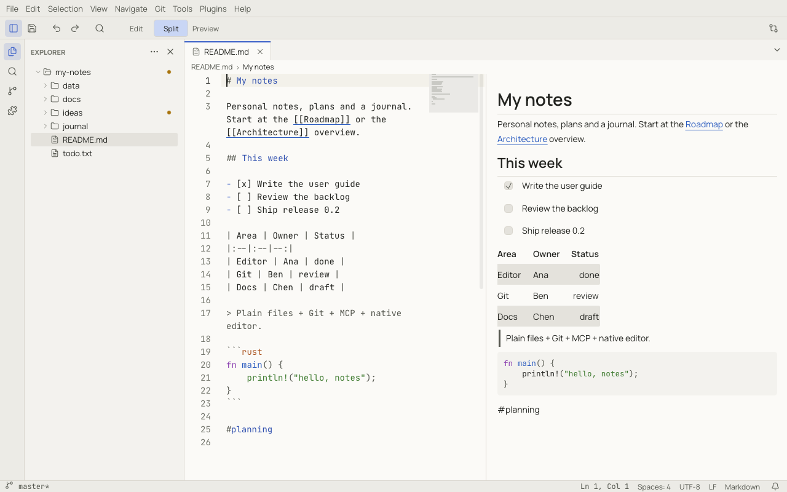

# Notoir

A fast, native, cross-platform text editor and workspace application written in Rust (egui/eframe).

> Plain files + Git + MCP + native editor.

Notoir opens a `.txt` file and lets you type immediately, like a notepad. When you need more, it also supports
workspaces, split editors, Markdown preview, JSON tree views, file comparison, Git, an MCP server, and Lua plugins.
None of these take up permanent screen space until you use them.

Runs on Windows 10/11, macOS (Apple Silicon and Intel), and Linux (X11/Wayland). Available in 14 languages.

**Documentation:** the [Notoir user guide](https://lvendrame.github.io/notoir/) covers every feature, with
screenshots, plus reference pages for shortcuts, settings, commands, the MCP tools and the Lua plugin API.



## Install

Download the installer for your system from the [latest release](https://github.com/lvendrame/notoir/releases/latest):

| System | File |
|---|---|
| macOS (Apple Silicon and Intel) | `Notoir_<version>_universal.dmg` |
| Windows | `notoir_<version>_x64_en-US.msi` or `notoir_<version>_x64-setup.exe` |
| Linux | `notoir_<version>_amd64.deb` or `notoir_<version>_x86_64.AppImage` |

Release builds are not code-signed yet, so the first launch needs one extra step:

- **macOS** says "Notoir" Not Opened. Drag Notoir to Applications, then run:
  ```sh
  xattr -dr com.apple.quarantine /Applications/Notoir.app
  ```
  (or click **Open Anyway** in System Settings → Privacy & Security).
- **Windows** SmartScreen says "Windows protected your PC": click **More info** → **Run anyway**.
- **Linux** AppImage: `chmod +x notoir_*.AppImage` before running it.

`SHA256SUMS.txt` in each release lists the checksum of every file. See
[Installing Notoir](https://lvendrame.github.io/notoir/install.html) for details and updates.

## Status

Early releases (0.1.x). Every planned milestone is built: files, workspaces, splits, crash recovery, find/replace and
workspace search, settings, Markdown preview, JSON tree view, file comparison, Git, the MCP server, Lua plugins, themes
and updates. Builds are not code-signed yet (see [Install](#install)). See:

- [`docs/specs/`](docs/specs/): functional and technical specifications (start with
  [`00-overview-and-scope.md`](docs/specs/00-overview-and-scope.md))
- [`docs/plan/orchestrator.md`](docs/plan/orchestrator.md): milestone plan and status
- [`docs/guide/`](docs/guide/): the user guide ([how it is built](docs/guide/README.md))

## Development

```sh
cargo run -p notoir
cargo fmt --check
cargo clippy --workspace --all-targets -- -D warnings
cargo test --workspace
```

## Packaging

Release packages are built per OS with [cargo-packager](https://github.com/crabnebula-dev/cargo-packager) 0.11
(`cargo install cargo-packager --version 0.11.8 --locked`):

```sh
scripts/package.sh   # macOS: universal .app + .dmg · Windows (Git Bash): .msi + NSIS · Linux: .deb + AppImage
```

Output, `SHA256SUMS-<os>.txt` and debug symbols land in `target/packages`. OS signing runs only when the credentials
named at the top of the script are set. The native crash suite runs nightly and on manual CI runs; ordinary
`cargo test --workspace` skips it. Run it locally with `cargo test -p notoir --test crash -- --ignored --test-threads=1`.

## Releasing

For the Microsoft Store distribution, follow [Store submission](docs/microsoft-store.md). Its dedicated
workflow builds the reserved MSIX product for Microsoft-managed signing after certification.

Follow the [release checklist](docs/releasing.md) before creating a release tag or enabling **publish**.
It covers version/lockfile preparation, dependency audits, local and native crash tests, the complete CI
matrix, a packaging preview, signing configuration and verification of the published artifacts.

Both the manual CI run (including all three native crash suites) and the packaging preview must pass
on the exact release commit before tagging. The Release workflow publishes independently of CI.
Updater signing requires `MINISIGN_SECRET_KEY` and `NOTOIR_UPDATE_PUBKEY`. Published Windows installers also
require a trusted Authenticode identity; see [Windows signing setup](docs/windows-signing.md).
macOS and Linux OS signing remain optional. Existing unsigned Windows releases may still show SmartScreen warnings.
