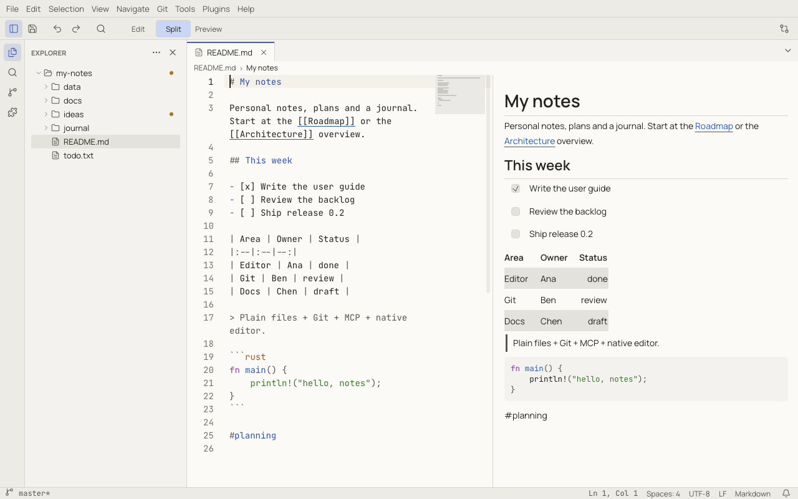

# Notoir

Notoir is a fast, native text editor and workspace for Windows, macOS and Linux.

It opens a `.txt` file and lets you type immediately, like a notepad. When you need more, the rest is there: folders
as workspaces, split editors, a Markdown preview, a JSON tree, file comparison, Git, an MCP server for AI clients and
Lua plugins. None of it takes up screen space until you use it.

> Plain files + Git + MCP + native editor.

## What makes it different

- **Your files stay plain files.** Notes are ordinary Markdown and text files in ordinary folders, so any other tool,
  Git, sync service or AI agent can work with them.
- **Nothing is lost.** Unsaved edits, untitled documents and scratchpads survive a crash or a forced quit. See
  [Files, scratchpads and recovery](files.md).
- **Native and quick.** Notoir is written in Rust and draws its own UI on the GPU. It starts fast and stays responsive
  with large files, because file, Git, search and plugin work never runs on the UI thread.
- **Everything is a command.** Menus, the toolbar, keyboard shortcuts, the [command palette](command-palette.md),
  plugins and MCP clients all run the same commands, so anything you can click can also be bound to a key or
  automated.
- **AI-ready.** The built-in [MCP server](mcp.md) lets Claude, Codex, Cursor, VS Code and other clients read and edit
  your documents through Notoir, behind permissions you control.

## How to read this guide

- New to Notoir? Start with [Installing Notoir](install.md), [First steps](first-steps.md) and
  [A tour of the window](window-tour.md).
- Looking for a feature? The chapters under *Working with files*, *Editing* and *Formats and tools* cover each area.
- Looking up a key, a setting or a command id? The [Reference](reference/shortcuts.md) pages are generated from the
  app itself and are always complete.

Shortcuts are written for Windows and Linux, with the macOS key in parentheses when it differs: `Ctrl+P` (⌘P).
Notoir uses ⌘ on macOS wherever Windows and Linux use Ctrl.

The screenshots use the light **Notoir Paper** theme. Notoir also ships the dark **Notoir Midnight** (the default) and
**Dracula** themes; see [Themes](themes.md).
