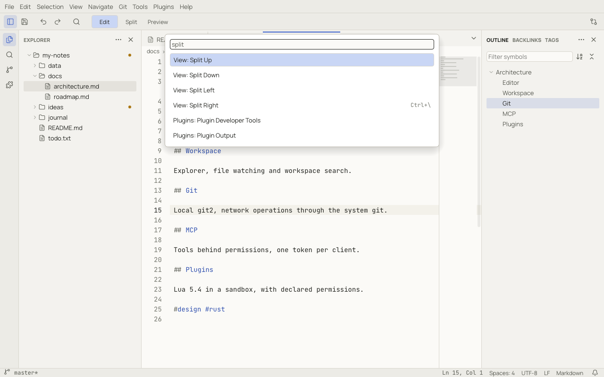

# The command palette

**View › Show All Commands** (`Ctrl+Shift+P`, ⇧⌘P) lists every command you can run right now, with its
shortcut. Type a few letters to filter: matching is fuzzy, so `tgww` finds *View: Toggle Word Wrap*.

- Commands are named *Category: Title*, such as *View: Split Right* or *Git: Commit*. Plugin commands appear as
  *Plugins: …*.
- In another display language you can still type the English name of a command.
- Recently used commands are listed first.
- Commands that do not apply right now are hidden. Turn on **show all** in the palette to see them dimmed.
- `Enter` runs the command, `Escape` closes the palette.

Some commands open a second picker, for example **Change Theme…** (`preferences.changeTheme`), which previews each theme
as you move through the list, or **Change Language Mode…**.

In [Quick Open](workspaces.md#quick-open), typing `>` switches to the command palette.

Every command also has an id (`view.splitRight`). Ids are what [keyboard shortcuts](keybindings.md),
[plugins](plugin-api.md#commands) and the menus use; the [Commands reference](reference/commands.md) lists them all.
