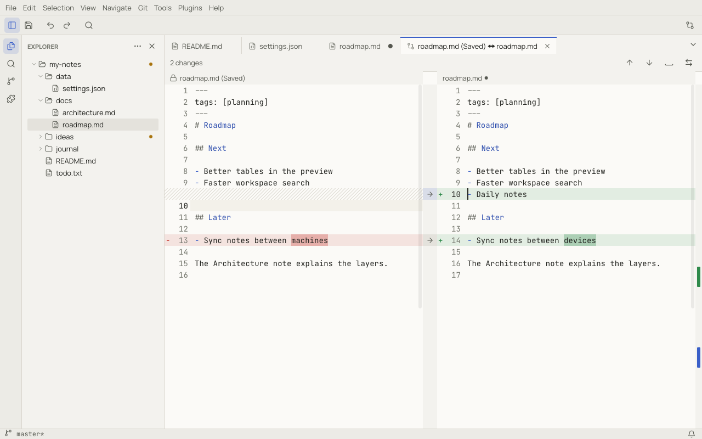

# Comparing files

Notoir compares two texts side by side, line by line, with the changed words inside each line highlighted.

## Starting a comparison

| To compare | Use |
|---|---|
| your unsaved edits with the file on disk | **Tools › Compare Current Changes** |
| any two files, open documents, the clipboard or the saved version | **Tools › Compare Files…** (or the toolbar button), then pick each side |
| two tabs or Explorer files | **Select for Compare** on the first, then **Compare with Selected** on the second |
| the current tab with something else | **Compare With…** in the tab menu |
| a file that changed on disk or after a crash | **Compare** in the file's banner (see [Files](files.md#files-changed-outside-notoir)) |
| a file with Git `HEAD` or an older revision | **Git › Compare with HEAD** / **Compare with Revision…** (see [Git](git.md)) |

The comparison opens in its own tab, titled with both sides (for example *roadmap.md (Saved) ↔ roadmap.md*).

## Reading the comparison

- The panes are aligned: hatched filler lines stand in for lines that exist only on the other side.
- Removed lines are red on the left, added lines green on the right, and the changed words inside a line are
  highlighted more strongly.
- Both panes scroll together. The ruler on the right shows where all changes are; click it to jump.
- The header counts the changes. **Next Change** (`F7`) and **Previous Change** (`Shift+F7`) move between them.

The comparison updates live while you edit either side.

## Acting on changes

- The arrows between the panes copy a change from one side to the other: **Copy Change to Right** / **Copy Change to
  Left**. A read-only side (such as the saved version or a Git revision) cannot be changed.
- **Revert Change** puts back the original lines.
- **Swap Sides** exchanges left and right.
- **Ignore Whitespace** and **Ignore Case** hide changes that only differ in spacing or letter case.

The `diff.algorithm` setting chooses between Patience (default, usually more readable) and Myers. Files larger than
`diff.maxSize` are not compared.
