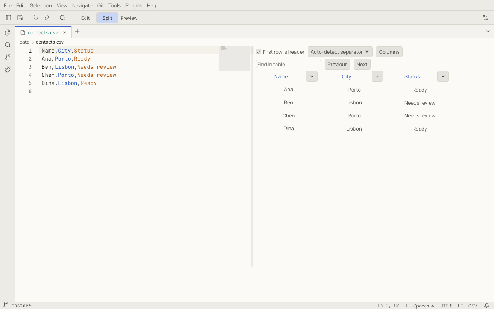
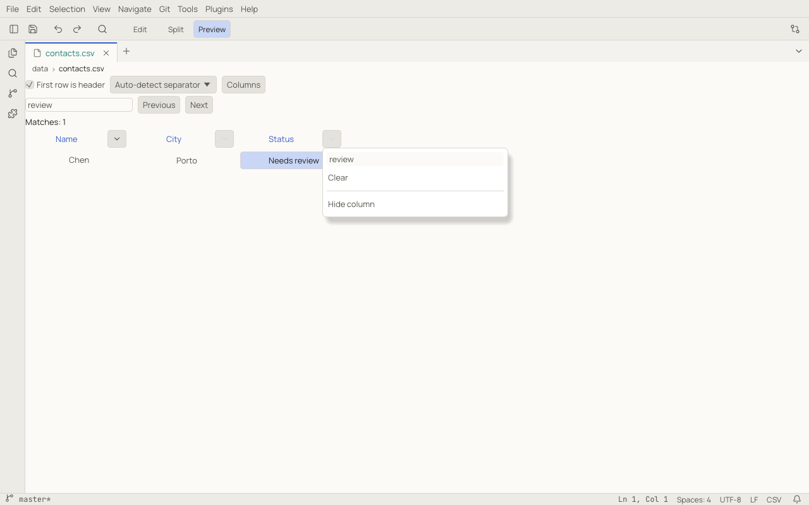
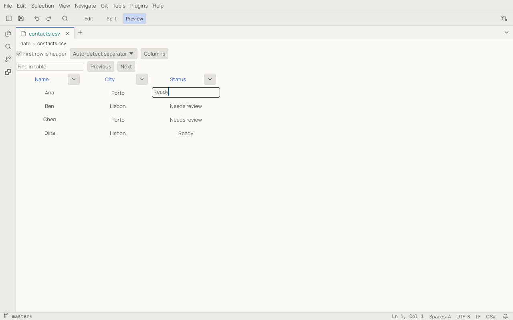

# CSV and TSV

Notoir opens comma-separated CSV (`.csv`) and tab-separated TSV (`.tsv`) files as text documents with an editable
table preview. You can work directly with the source, use the table, or keep both visible.

## Edit, Split and Preview

The toolbar shows **Edit / Split / Preview** when a CSV or TSV document is active:

| Mode | Shows | Command Palette command |
|---|---|---|
| Edit | the source text only | Show Editor |
| Split | source text and the table together | Show Editor and Preview |
| Preview | the editable table only | Show Preview |



The table and text share the same document: a cell edit changes the source, and a text edit updates the table.
Use the horizontal scrollbar for wide tables and the vertical scrollbar for longer files.

For example, save this text as `contacts.csv` and choose **Split**:

```csv
Name,City,Status
Ana,Porto,Ready
Ben,Lisbon,Needs review
Chen,Porto,Needs review
Dina,Lisbon,Ready
```

## Headers and separators

**First row is header** is checked by default. In the example, `Name`, `City` and `Status` become column headings.
Uncheck it if the first row contains data: that row appears in the table, and the headings become **Column 1**,
**Column 2**, **Column 3**, and so on. Empty or missing header cells also receive numbered headings.

The separator selector starts at **Auto-detect separator**. Notoir recognizes commas, semicolons and tabs. If the
columns do not look right, choose **Comma**, **Semicolon** or **Tab** explicitly. For example, a file beginning with
`Name;City;Status` should use **Semicolon**.

Header and separator choices only change how you view the document. They do not insert a header, convert separators
or rewrite the file.

## Finding values

Type into **Find in table** to highlight matching cells. Search ignores case and matches part of a value, so
`REVIEW` finds both `Needs review` cells in the example. The match count appears below the controls; **Previous**
and **Next** move between matching cells and scroll them into view.

Search keeps rows visible. It searches visible columns within the rows allowed by your column filters. If a value
seems missing, check whether its column is hidden or its row is filtered out. Clear the search input to remove the
highlights.

## Filtering rows

Click the small arrow beside a column heading to open its filter popover. Type part of a value into the input to
keep only matching rows. Filters ignore case and apply as you type. Choose **Clear** in that popover to remove that
column's filter.



Filters on different columns combine: a row must match every active filter. With the sample above:

1. Filter **City** by `porto`: Ana and Chen remain.
2. Filter **Status** by `review`: only Chen remains.
3. Clear the Status filter: Ana and Chen reappear.
4. Clear the City filter: all four rows return.

An empty table body means no rows match the active filters. Clearing **Find in table** does not clear column filters.

## Hiding and restoring columns

There are two ways to hide a column:

- Open its heading's filter popover and choose **Hide column**.
- Open **Columns** and uncheck the column's name.

To restore it, open **Columns** and check its name. **Show all** restores every column, including when all columns
have been hidden.

Hiding a column does not delete its data. Its filter continues to apply while it is hidden. For example, hiding
Status after filtering it by `review` still excludes the Ready rows. Restore the column and clear its filter when
you want those rows back. **Show all** restores visibility; it does not clear filters.

## Editing cells

Double-click a data cell to edit its value directly in the table. To rename a header, edit the first row in Edit or
Split mode.



| Action | Result |
|---|---|
| Enter | apply the new value |
| Shift+Enter | insert a newline within the value |
| Escape | cancel the cell edit |
| Click outside the cell | apply the new value |

Each applied cell edit is one undo step. Use **Edit → Undo** (`Ctrl+Z`, or ⌘Z on macOS) to restore the previous value,
and Redo to apply it again. If you edit a filtered column so that the row no longer matches, the row disappears
from the filtered table; its updated data remains in the document.

Notoir adds CSV quoting when a value contains the selected separator, a quote or a line break. For example, entering
`Ready, approved` in Ana's Status cell produces:

```csv
Ana,Porto,"Ready, approved"
```

A quote inside a quoted value is doubled in the source. You enter `He said "ready"`; Notoir writes
`"He said ""ready"""`. Existing quoted values, unrelated cells and file line endings are preserved.

Rows with fewer fields display empty cells up to the widest row. Editing one of those cells adds the needed
separators. Trailing empty fields and quoted values spanning several lines are supported.

Cell edits change the open document. Use **File → Save** (`Ctrl+S`, or ⌘S) to write them to disk, or use your existing
[auto-save preferences](files.md#auto-save). Read-only documents can be viewed but their table cells cannot be edited.

## Errors and limits

If a source edit makes the CSV invalid, the preview reports a line and column and keeps the last valid table greyed
out. Cell editing is paused until the text is valid again. For example, an opening quote without its closing quote
causes an error: switch to **Edit** or **Split** to correct it, or undo the text change.

**Updating table…** means the preview is catching up with the source. Wait for it to finish before editing cells.
CSV table preview is limited to **20 MiB**; use Edit mode for larger documents.

## What is remembered

The mode, header choice, separator override, hidden columns, search and filters belong to the current view. They
reset when you close and reopen the document and are not restored with the next session. These display choices
are never written into the CSV or TSV file. Applied cell edits are document changes and follow the normal save flow.
