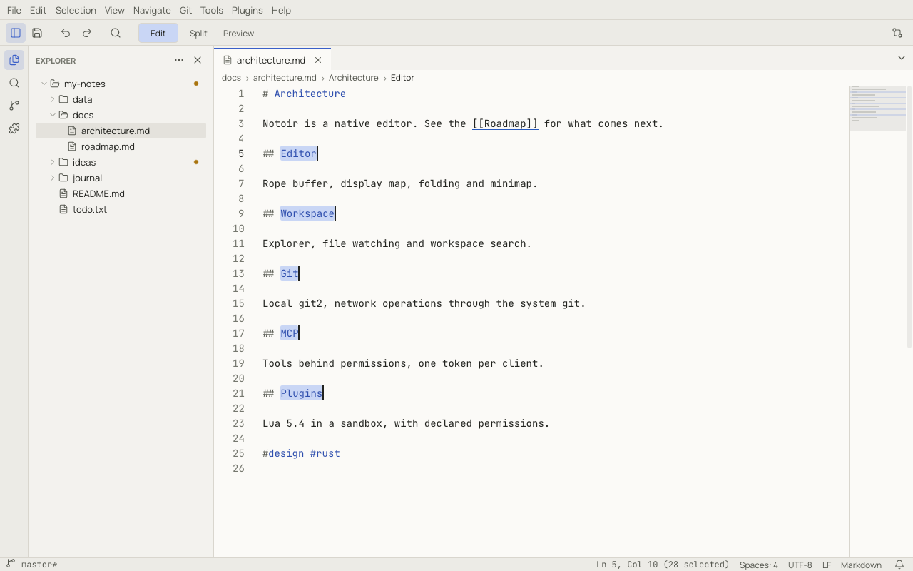

# Editing text

## The basics

Notoir edits text the way you expect from a modern editor:

- Moving and deleting work by character or by word (`Ctrl` / `⌥` with arrows and Backspace), respecting emoji and
  other multi-character symbols.
- `Enter` keeps the indentation of the line. In Markdown it also continues lists and task lists.
- `Tab` and `Shift+Tab` indent and outdent the selected lines.
- Copy and Cut with nothing selected act on the whole line (`editor.emptySelectionClipboard`).
- Input methods for Chinese, Japanese and Korean work in the editor.
- **Undo** (`Ctrl+Z`, ⌘Z) and **Redo** (`Ctrl+Shift+Z` or `Ctrl+Y`, ⇧⌘Z) group your typing into sensible steps.

Right-clicking never moves the cursor, so the context menu always acts on your current selection.

## Multiple cursors

| To | Use |
|---|---|
| Add a cursor anywhere | `Alt`+click (⌥+click) |
| Add a cursor on the line above / below | `Ctrl+Alt+Up` / `Ctrl+Alt+Down` (⌥⌘↑ / ⌥⌘↓) |
| Select the next occurrence of the selection | `Ctrl+D` (⌘D) |
| Select all occurrences | `Ctrl+Shift+L` (⇧⌘L) |
| Select a rectangle (column selection) | `Shift+Alt` + drag (⇧⌥ + drag), or **Selection › Column Selection Mode** |
| Go back to one cursor | `Escape` |

Everything you type, paste or delete happens at every cursor. Pasting as many lines as there are cursors puts one
line at each cursor.

**Expand Selection** (`Alt+Shift+Right`, ⌃⇧⌘→) grows the selection to the word, the string, the bracket block, the
line and so on; **Shrink Selection** (`Alt+Shift+Left`, ⌃⇧⌘←) goes back.

## Line operations

| Command | Shortcut |
|---|---|
| Duplicate Line | `Ctrl+Shift+D` (⇧⌘D) |
| Delete Line | `Ctrl+Shift+K` (⇧⌘K) |
| Move Line Up / Down | `Alt+Up` / `Alt+Down` (⌥↑ / ⌥↓) |
| Insert Line Below / Above | `Ctrl+Enter` / `Ctrl+Shift+Enter` (⌘↩ / ⇧⌘↩) |
| Join Lines | — |
| Sort Lines Ascending / Descending | — |
| Trim Trailing Whitespace | — |
| Transform to Uppercase / Lowercase / Title Case | **Edit › Convert Case** |

Commands without a shortcut are in the **Edit** menu and the [command palette](command-palette.md); you can give them
one in [Keyboard shortcuts](keybindings.md).

## Formatting

**Tools › Format Document** reformats the whole document when a formatter exists for its language: JSON has one built
in (see [JSON](json.md)), and plugins can add more, like the Markdown table formatter in the
[example plugins](writing-plugins.md).

## Indentation, encoding and line endings

Click **Spaces: 4** in the status bar to switch between spaces and tabs, change the tab size, detect the indentation
from the content again, or convert the whole file. The encoding and line-ending items next to it change how the file
is saved. See [Files](files.md#opening-files).

## Copying a reference to the code

Right-click in the editor and choose **Copy Full Reference** or **Copy Relative Reference** to copy the file path with
the line (or line range) of the selection, such as `docs/architecture.md:15` or `docs/architecture.md:15-19`. This is
handy for pasting a location into a chat with an AI agent or into an issue. The relative form needs the file to be
inside the workspace.

## Read-only documents

**Edit › Toggle Read-Only** locks a document against accidental edits, or unlocks one that Notoir opened read-only.
