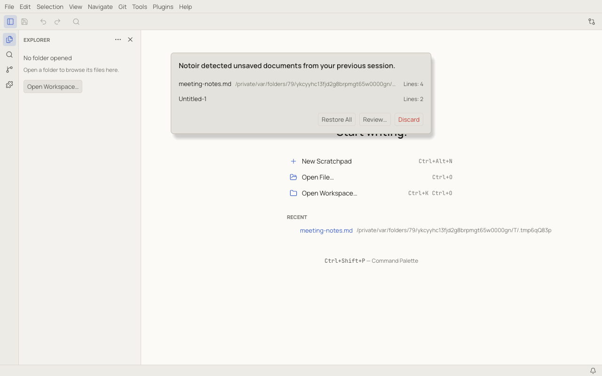
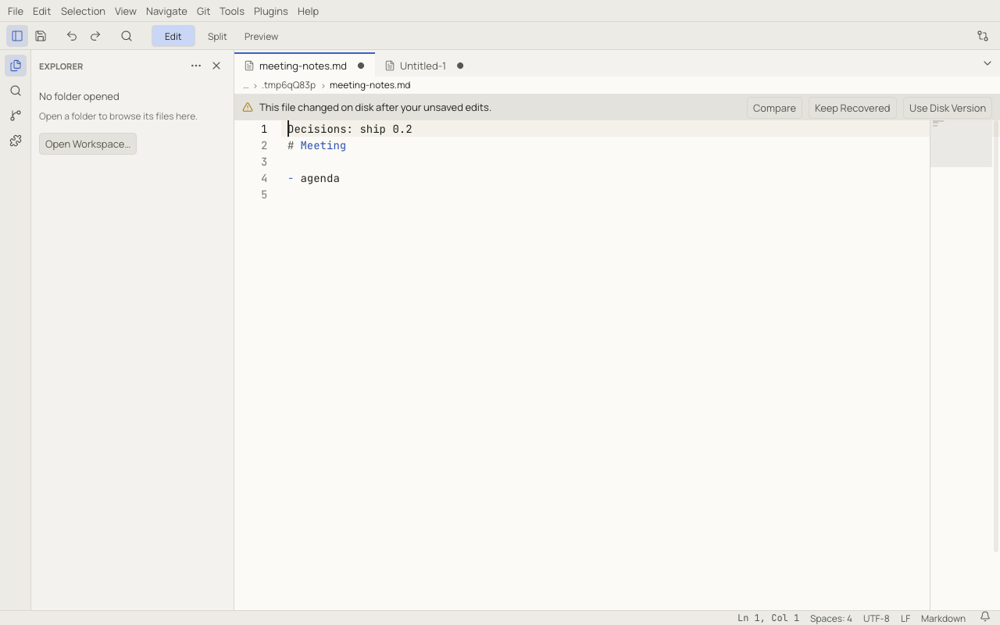
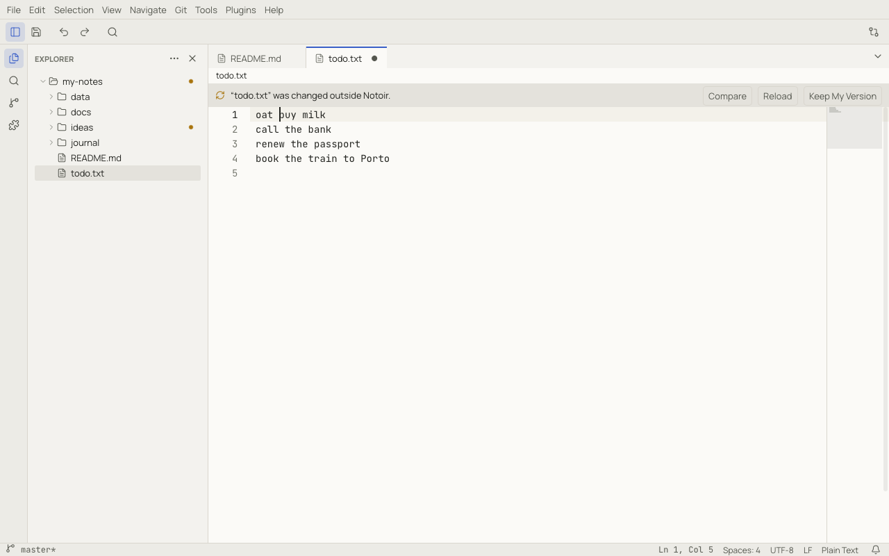
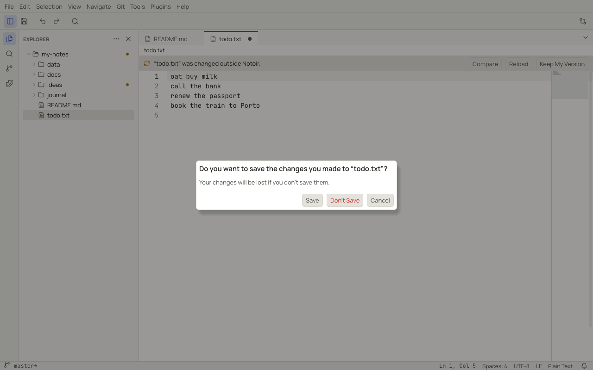

# Files, scratchpads and recovery

## Untitled files and scratchpads

- **File › New File** (`Ctrl+N`, ⌘N) creates `Untitled-1`, `Untitled-2`… The first save asks for a name.
- **File › New Scratchpad** (`Ctrl+Alt+N`, ⌥⌘N) creates `Scratch 1`, `Scratch 2`… A scratchpad has no file: Notoir
  saves its content in its own data folder as you type, even with auto save off. Scratchpads are global (not tied to a
  workspace) and come back after a restart or a crash.

Closing a scratchpad that has text asks what to do with it:

- **Keep Scratchpad** closes the tab and keeps the note. Reopen it from **File › Open Recent › Scratchpads** or Quick
  Open.
- **Save As…** turns it into a normal file.
- **Delete** throws it away.

An empty scratchpad is deleted silently. New scratchpads are Markdown; change that with `scratchpad.defaultLanguage`.

## Opening files

- **File › Open File…** (`Ctrl+O`, ⌘O) opens one or more files. They do not need to be inside a workspace.
- Drag files from your file manager onto an editor group to open them there. Dropping a folder opens it as a workspace.
- **File › Open Recent** lists recent workspaces and files (pinned ones first) and kept scratchpads. **Clear Recently
  Opened** empties the list.
- Opening a file that is already open switches to its tab.
- From a terminal: `notoir notes.md`. See [Command line](cli.md).

Notoir detects the **encoding** (UTF-8 with or without BOM, UTF-16 and common legacy encodings), the **line endings**
and the **indentation** of each file, and keeps them when saving. Click them in the status bar to change them: the
encoding item offers **Reopen with Encoding** and **Save with Encoding**.

A file that looks binary asks first and then opens read-only. A file that cannot be decoded cleanly opens read-only
too, so you can reopen it with the right encoding before saving.

Files over 20 MiB, over 300,000 lines or with a line longer than 20,000 characters open in **large-file mode**: syntax
highlighting, the minimap, outline symbols and the live Markdown preview are turned off to keep editing fast. Files over
2 GiB are not opened.

## Saving

| Command | Shortcut |
|---|---|
| Save | `Ctrl+S` (⌘S) |
| Save As… | `Ctrl+Shift+S` (⇧⌘S) |
| Save All | `Ctrl+Alt+S` (⌥⌘S) |
| Revert File (discard unsaved changes) | — |

Saves are atomic: Notoir writes a temporary file and swaps it in, so a crash during a save never leaves a half-written
file. If the file changed on disk since you opened it, the save asks before overwriting.

### Auto save

Choose a mode in **File › Auto Save** or with the `files.autoSave` setting:

| Mode | Saves |
|---|---|
| Off (default) | only when you save |
| After Delay | after you stop typing for `files.autoSaveDelay` ms (default 1000) |
| On Focus Change | when you switch to another tab or panel |
| On Window Focus Loss | when Notoir loses focus |

Untitled files are never auto-saved; they need a name first.

### Protected files

If saving fails because you lack permission (a system file, for example), Notoir offers **Save as Administrator…**. It
asks for your password through the operating system and writes the file with its owner and permissions unchanged. If
you cancel, the document stays unsaved and is still protected by recovery.

A document you cannot write (or that you lock yourself) is read-only. **Edit › Toggle Read-Only** locks or unlocks it.

## Crash recovery

Notoir keeps a recovery snapshot of every document with unsaved changes: untitled files, edited files and
scratchpads. Snapshots are written in the background a moment after you stop typing, when Notoir loses focus, and when
you quit.

When you quit with unsaved changes, Notoir keeps them (this is called *hot exit*) and restores them silently the next
time. Turn this off with `app.hotExit`; Notoir then asks to save each document when you quit.

After a crash, Notoir lists what it found:

- **Restore All** reopens everything.
- **Review…** lets you restore or discard each document on its own.
- **Discard** drops the snapshots (they are kept aside for 7 days).

If a recovered file was also changed on disk after your unsaved edits, its tab shows a banner:

- **Compare** opens a side-by-side comparison of the two versions.
- **Keep Recovered** keeps your edits (the next save overwrites the disk version).
- **Use Disk Version** drops your edits.

**Help › Recover Unsaved Documents…** shows the recovery list again at any time.

## Files changed outside Notoir

Notoir watches open files and the workspace. When another program changes a file:

- A file without unsaved changes reloads automatically. The reload is a normal edit, so **Undo** brings your previous
  text back.
- A file with unsaved changes keeps your text and shows a banner:

  **Compare** shows the differences, **Reload** takes the disk version, and **Keep My Version** keeps yours.
- A deleted file keeps its tab and shows a banner offering **Save** (to write it back) or **Close**.
- When an AI client changes a file through MCP, the banner names the client.

## Closing

Closing a document with unsaved changes asks **Save**, **Don't Save** or **Cancel**:

**File › Close Others**, **Close All** and the tab context menu close several tabs at once and ask once for all of
them. **View › Reopen Closed Tab** (`Ctrl+Shift+T`, ⇧⌘T) brings back the last closed tab.
