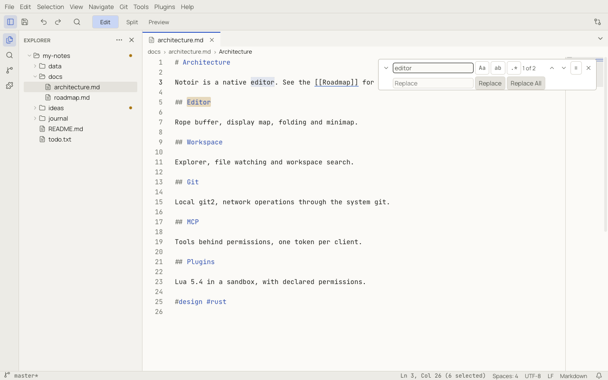
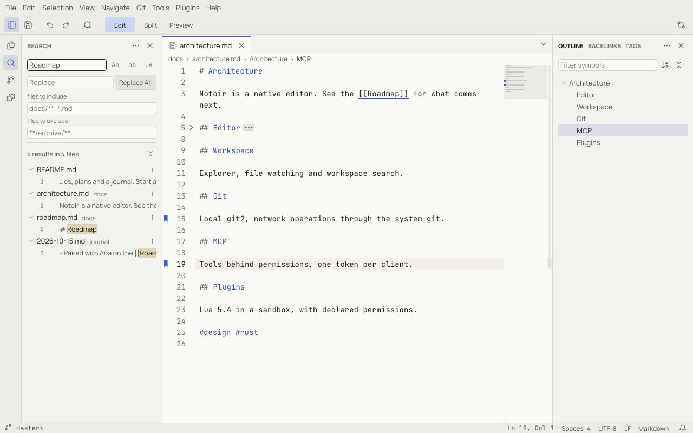

# Find, replace and workspace search

## Find and replace in a document

**Edit › Find** (`Ctrl+F`, ⌘F) opens the find widget over the editor; **Edit › Replace** (`Ctrl+H`, ⌥⌘F) opens it with
the replace row. If text is selected, it becomes the search term.

| Button | Meaning |
|---|---|
| `Aa` | Match Case |
| `ab` | Match Whole Word |
| `.*` | Use Regular Expression (replacements can use `$1`, `$2`… for captured groups) |
| `≡` | Find in Selection: search only inside the selected text |

While the widget has focus, `Alt+C`, `Alt+W` and `Alt+R` (⌥C, ⌥W, ⌥R) toggle case, whole word and regular expression.

The widget shows the match count (*1 of 2*). `Enter` / `Shift+Enter`, or `F3` / `Shift+F3` (⌘G / ⇧⌘G), go to the next
and previous match, wrapping at the end of the document. The minimap marks every match.

**Replace** replaces the current match; **Replace All** replaces every match in one step, so a single **Undo**
reverts it. `Escape` closes the widget.

## Search in the workspace

**Edit › Search in Workspace** (`Ctrl+Shift+F`, ⇧⌘F) opens the Search panel. Results appear while Notoir searches,
grouped by file, with the matching line.

- The same `Aa`, `ab` and `.*` options as the find widget.
- **files to include** and **files to exclude** take globs, such as `docs/**, *.md` or `**/archive/**`.
- Files ignored by `.gitignore`, `files.exclude` and `search.exclude`, binary files and files larger than
  `search.maxFileSize` are skipped.
- Open documents are searched as they are in Notoir, including unsaved edits.
- Click a result to open it at the match. **Next Search Result** (`F4`) and **Previous Search Result** (`Shift+F4`)
  step through results without leaving the editor.
- Right-click a file or a match for **Open to the Side**, **Copy Path**, **Replace in File**, **Replace** and
  **Dismiss** (hide it from the list).

### Replace across files

Type the replacement in the panel's **Replace** field and click **Replace All**. Notoir asks for confirmation, then:

- open documents get one undoable edit each;
- closed files are rewritten through the normal save pipeline, which refuses to overwrite a file that changed in the
  meantime;
- a notification reports the result and offers **Undo**.

### Search from a folder

Right-click a folder in the Explorer and choose **Find in Folder…** to search only inside it.

Large workspaces are searched through a full-text index; see
[Notes › Full-text search index](notes.md#full-text-search-index).
