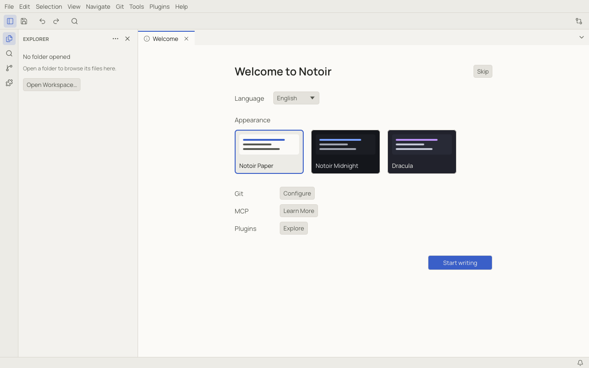

# First steps

## The first launch

The first time Notoir starts, it opens the **Welcome** page. Pick the display language and a theme; the theme applies
as you click it. The buttons next to **Git**, **MCP** and **Plugins** open those settings, the MCP Connections dialog and
the Plugin Manager. Click **Start writing** (or **Skip**) to begin. **Help › Welcome** brings the page back later.

## Just type

With nothing open, Notoir shows a short start screen: **New Scratchpad**, **Open File…**, **Open Workspace…** and your
recent files. You do not have to choose: start typing and Notoir creates a scratchpad for you.

A **scratchpad** is a note that is kept for you without a file name. It is saved continuously in Notoir's own data
folder and survives restarts and crashes, so you can treat Notoir like a notepad that never loses anything. When a
scratchpad deserves a real file, use **File › Save As…**. See [Files, scratchpads and recovery](files.md).

## Open and save files

| To | Use |
|---|---|
| Create an untitled file | **File › New File**, `Ctrl+N` (⌘N) |
| Create a scratchpad | **File › New Scratchpad**, `Ctrl+Alt+N` (⌥⌘N) |
| Open a file | **File › Open File…**, `Ctrl+O` (⌘O), or drag it onto the window |
| Save | **File › Save**, `Ctrl+S` (⌘S) |
| Save under a new name | **File › Save As…**, `Ctrl+Shift+S` (⇧⌘S) |
| Close the tab | **File › Close**, `Ctrl+W` (⌘W) |

Notoir detects each file's encoding, line endings and indentation and keeps them when it saves. The status bar shows
them and lets you change them (see [A tour of the window](window-tour.md)).

## Open a folder as a workspace

Most work happens in a folder: a notes folder, a project or a repository. Open it with **File › Open Workspace…**
(`Ctrl+K Ctrl+O`, ⌘K ⌘O), by dragging the folder onto the window, or with `notoir .` in a terminal. The Explorer shows
its files, [Quick Open](workspaces.md#quick-open) finds any of them by name, and Notoir remembers the tabs and layout of
each workspace. See [Workspaces and the Explorer](workspaces.md).

## Find any command

Press `Ctrl+Shift+P` (⇧⌘P) or `F1` to open the [command palette](command-palette.md) and type what you want to do:
"split", "theme", "word wrap"… Every command in Notoir is listed there with its shortcut.

## Where next

- [A tour of the window](window-tour.md) names every part of the screen.
- [Editing text](editing.md) covers multiple cursors, line operations and the find widget.
- [Markdown](markdown.md) explains the preview and split modes.
