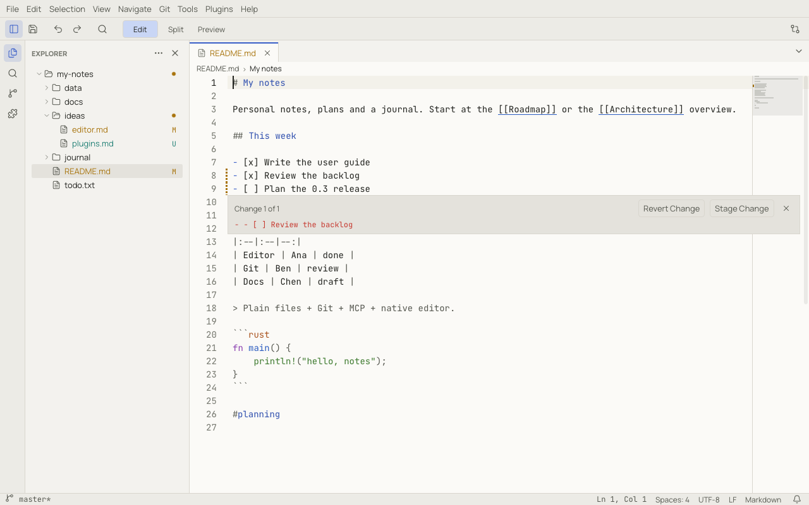
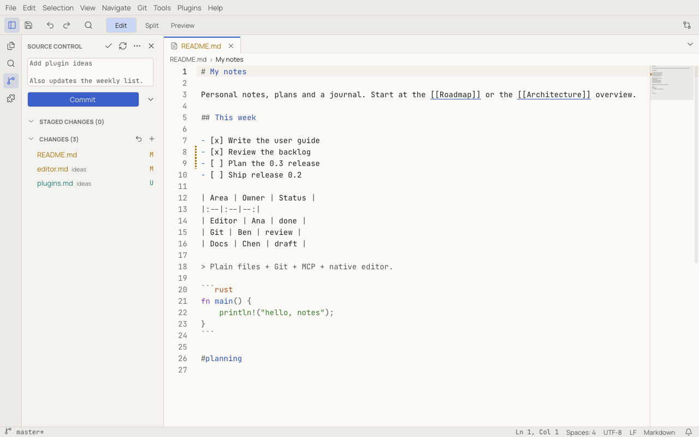

# Git

When a workspace is a Git repository, Notoir shows what changed and lets you commit, branch, pull and push without
leaving the editor. Reading the repository uses a built-in Git library; network operations (fetch, pull, push, clone)
run your installed `git`, so your credentials, SSH keys and hooks work as usual. Git never freezes the UI and never
pushes unless you ask.

## Seeing changes

- **Explorer and tabs:** changed files are coloured, with a letter (`M` modified, `U` untracked, `A` added, `D`
  deleted, `!` conflicted). Folders with changes get a dot.
- **Gutter:** a bar next to the line numbers marks added lines (solid), modified lines (dashed) and deleted lines (a
  small wedge). The minimap shows the same marks. `git.gutterBase` chooses whether they compare with the index
  (default) or with `HEAD`.
- **Status bar:** the branch, `*` when there are uncommitted changes, and the commits ahead (`↑`) and behind (`↓`) the
  upstream. During a merge or rebase it says *MERGING* or *REBASING*.

Click a change bar in the gutter to see the original lines:

**Revert Change** puts the original lines back (undoable); **Stage Change** stages just that change. `Escape` closes
the peek.

## Source Control

**Git › Show Source Control** (or the branch icon in the activity bar) opens the Source Control panel.

- Write the message at the top. A ruler marks column 72. `Ctrl+Enter` (⌘↩) commits.
- The **Commit** button's arrow offers **Commit All**, **Commit & Push** and **Amend Last Commit**.
- **Staged Changes**, **Changes** and **Merge Conflicts** list the files. Hover a file for quick actions (open, stage,
  unstage, discard) or right-click it for more. Click a file to see its changes.
- If you commit with nothing staged, Notoir asks whether to commit all changes (`git.smartCommit`).
- **Discard Changes…** always asks first. Discarded untracked files go to the trash.

The **Git Output** panel (**Git › Show Git Output**) shows every git command Notoir runs and its output. Long
operations show progress in the status bar and can be stopped with **Cancel Git Operation**.

## Branches

Click the branch in the status bar, or use **Git › Branches**:

- **Switch Branch…** lists local and remote branches; picking a remote branch creates a local tracking branch.
- **Create Branch…** creates a branch from the current commit; **Create Branch From…** lets you pick the start.

If you have unsaved documents, Notoir offers to save them first. A switch that would overwrite local changes is
refused with git's explanation. Open files that change on disk because of a checkout reload automatically.

## Pull, push and sync

| Command | What it does |
|---|---|
| **Fetch** | downloads new commits without changing your files |
| **Pull** | fetches and integrates the upstream branch, as set by `git.pullMode` (fast-forward only by default; **Pull (Rebase)** and **Pull (Merge)** in the palette) |
| **Push** | uploads your commits; the first push of a new branch publishes it |
| **Sync** | pull, then push (asks once per workspace, `git.confirmSync`) |

If the branches have diverged and fast-forward is not possible, Notoir asks how to continue. Options:
`git.autoFetch` (with `git.autoFetchPeriod`), `git.pullOnOpen` and `git.autoPush`, all off by default.

## History and older versions

- **Compare with HEAD** compares the current file with its last committed version.
- **Compare with Revision…** and **File History** list the commits that touched the file; pick one to compare with
  it.
- **Open File at Revision…** opens the file as it was in a commit (read-only).
- **View File Changes** shows the file's uncommitted changes.

See [Comparing files](compare.md) for working in the comparison tab.

## New repositories

- **Git › Initialize Repository** turns the workspace into a repository.
- **Git › Clone Repository…** asks for a URL and a folder, clones it, and offers to open it.

Repositories in direct subfolders of the workspace are detected when `git.scanNestedRepos` is on; Source Control then
lets you choose the repository.

## Sync Notes

For a notes workspace kept in a Git repository, **Git › Sync Notes** does the whole round trip in one go:

1. saves all modified documents in the workspace,
2. commits everything with the message from `notes.sync.commitMessage`
   (default `Notes sync {{date}} {{time}} from {{hostname}}`),
3. fetches, and rebases onto the remote only when no conflict is predicted,
4. pushes.

If a conflict is likely, it stops after the commit and opens Source Control with an explanation; nothing is ever
reset or force-pushed. Enable it with `notes.sync.enabled` (it needs a trusted workspace).

## Commit and push on save

Choose **File → Auto Commit → On Manual Save** to commit after Save, Save As, or Save All. The preference is off by
default and applies to the current workspace. Autosave does not trigger commits. Save All creates one commit per
repository containing successfully saved, changed files. Failed/cancelled saves and ignored files are excluded.
Other files' staged changes stay outside these commits; staged hunks in a saved file are included in its full save.

A single-file commit uses `File saved - meeting.md - Date: 2026-10-21 Time: 14-32-08`. A multi-file commit uses
`Save files - 2026-10-21 14:32:08`, followed by a blank line and sorted repository-relative paths, one per line.
Dates and times use your local timezone.

Enable **File → Auto Commit → Auto Push** to push after manual and automatic commits. This sends **all pending commits on the branch**.
It requires Auto Commit to be enabled. Your explicit choice is remembered locally for this workspace without trusting its other settings. Turning Auto Commit off also turns
Auto Push off. Publishing a branch requires confirmation. Push failures keep local commits and offer Retry and Git
Output; Notoir does not force-push or pull automatically to resolve rejection.

If you initialize Git outside Notoir, it detects the repository automatically. You can also click **Refresh Git Status**
above **Initialize Repository** in Source Control or switch away from Notoir and back to trigger detection.
