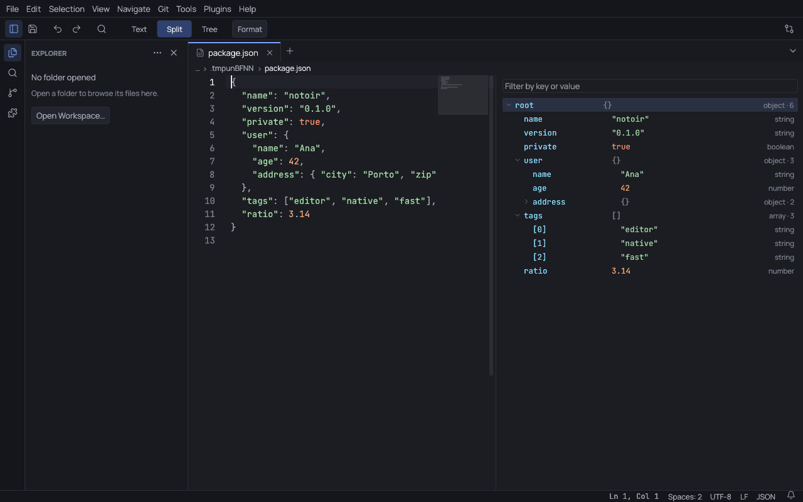
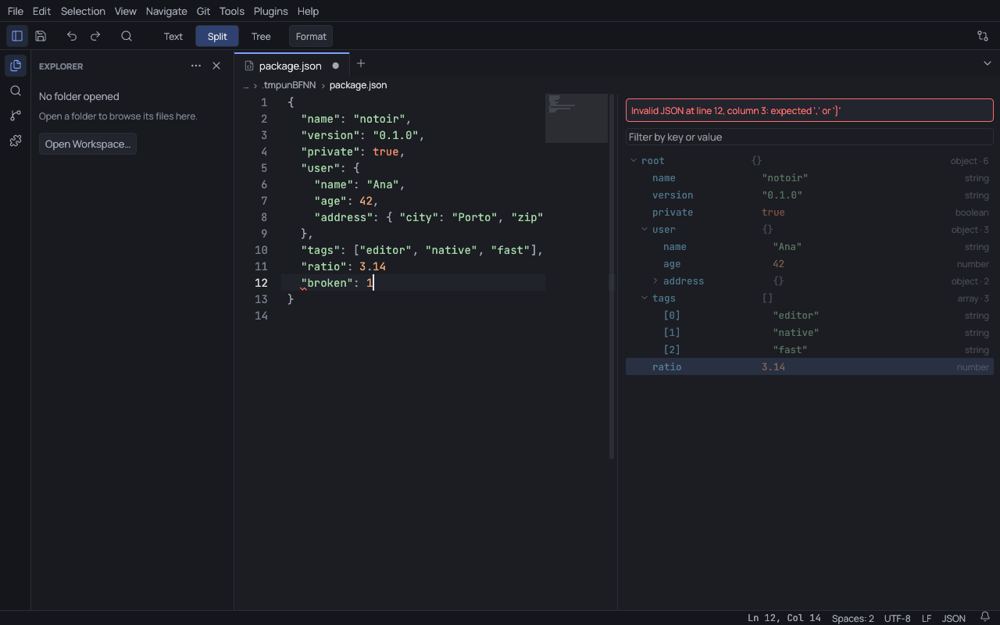
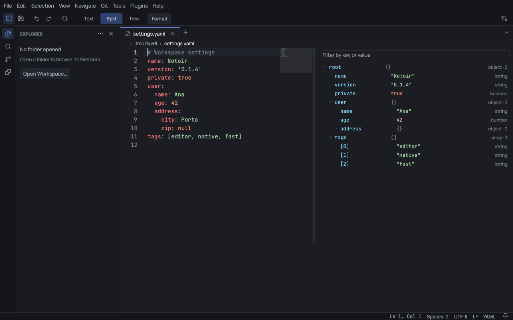

# JSON and YAML

Notoir understands JSON, JSON with comments (JSONC), JSON Lines, and YAML (`.yaml` and `.yml`).

## Text, Split and Tree

For a JSON file the toolbar shows **Text / Split / Tree** and **Format**:

- **Text** is the plain editor.
- **Tree** shows the document as an expandable tree, with each value's type and the size of objects and arrays.
- **Split** shows both, kept in sync: selecting a node selects its text, and moving the cursor highlights the node.

The **Filter by key or value** box narrows the tree. Right-click a node to copy its path or value, or to edit it.

## Editing in the tree

- Double-click a value, or use **Edit Value** in its context menu, to change it. Strings, numbers, `true`, `false`
  and `null` are checked before the edit is applied.
- **Rename Key** renames a property; a duplicate name is refused.
- **Add Property** / **Add Element** inserts a new item of the type you pick, indented like its siblings.
- **Delete** removes the item with its separating comma.
- **Move Up** / **Move Down** reorder items.

Each tree edit is a small text change that keeps your formatting and comments, and can be undone like typing. While
the text has a syntax error, tree editing is paused.

## Errors

When the text is not valid JSON, a banner above the tree names the line and column, the editor underlines the spot,
and the tree keeps showing the last valid version, greyed out:

## Commands

| Command | What it does |
|---|---|
| Format (**Tools › Format Document**) | re-indents the document, keeping comments |
| Minify | removes all whitespace |
| Sort Keys | sorts object keys alphabetically |
| Go to Parent | moves the cursor to the enclosing object or array |

The [Outline](navigation.md#outline) and breadcrumbs show the key path at the cursor, down to `outline.depth` levels.

## YAML

YAML has the same **Text / Split / Tree** controls and tree editing actions. Comments, quotes and line endings are
preserved when you edit a node, and each operation is one undo step. A YAML stream with multiple documents shows one
root per document. Aliases and tagged values stay literal; complex keys can be changed in the text editor. Changes
that would break an alias or make the YAML invalid are refused.

**Format** normalizes YAML indentation and separator spacing while keeping comments and key order. The YAML palette
also includes **Go to Parent**. Minify and Sort Keys remain JSON commands.

