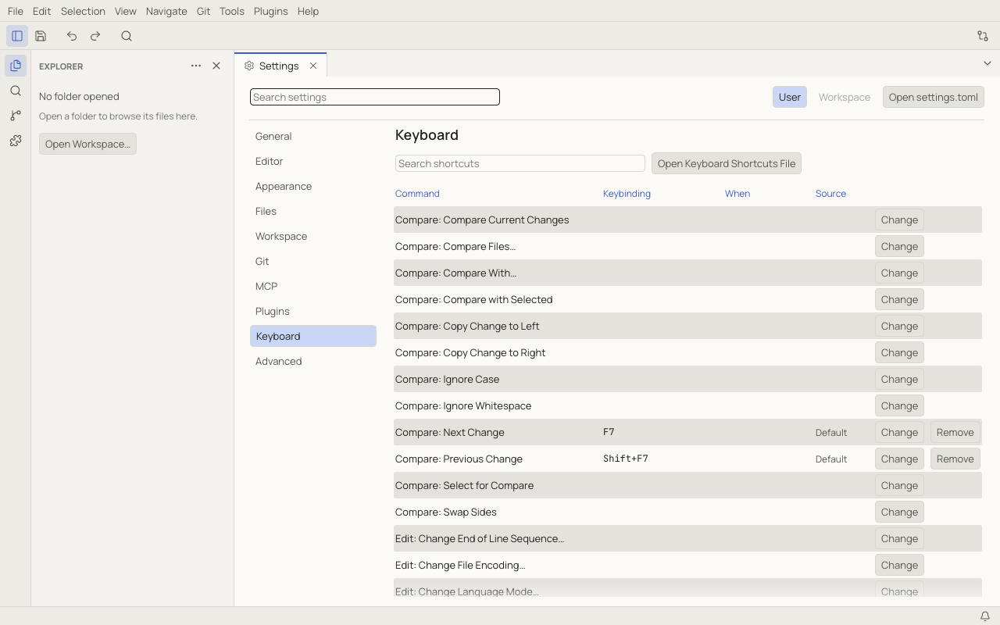

# Keyboard shortcuts

All default shortcuts are listed in the [Keyboard shortcuts reference](reference/shortcuts.md).

## The shortcuts editor

Open **Settings › Keyboard**, or run **Preferences: Keyboard Shortcuts** from the palette.



- **Search shortcuts** filters by command name or by key.
- **Change** records a new shortcut: press it, then `Enter` to finish a one-key shortcut (two-stroke chords finish on
  their own); `Escape` cancels.
- **Remove** removes a shortcut.
- The **Source** column says whether a shortcut is a default, from a plugin, or yours.
- Conflicting shortcuts are marked with a warning.

## The keybindings file

Your changes are stored in `keybindings.toml` in the config folder. Open it with **Open Keyboard Shortcuts File**.
Saved edits apply immediately.

```toml
# Save All with Ctrl+Shift+S (⇧⌘S on macOS).
[[binding]]
key = "Mod+Shift+S"
command = "file.saveAll"

# Bold only in Markdown editors.
[[binding]]
key = "Mod+B"
command = "markdown.toggleBold"
when = "editorFocus && languageId == 'markdown'"

# Remove the default Delete Line shortcut.
[[binding]]
key = "Mod+Shift+K"
command = "-edit.deleteLine"
```

| Field | Meaning |
|---|---|
| `key` | the shortcut. `Mod` is ⌘ on macOS and Ctrl elsewhere; other modifiers are `Ctrl`, `Alt` (⌥), `Shift` and `Cmd` (⌘, or the Windows / Super key). Two strokes are separated by a space: `Mod+K Mod+O`. |
| `command` | a command id from the [Commands reference](reference/commands.md). A leading `-` removes that command's binding for this key. |
| `when` | optional condition, such as `editorFocus`, `hasWorkspace`, `languageId == 'markdown'`, combined with `&&`, `\|\|`, `!`, `==` and `!=` |
| `args` | optional arguments for the command, as a TOML table |

Your bindings take precedence over plugin bindings, which take precedence over the defaults. When several bindings
match, the first one whose `when` is true wins.

After the first stroke of a two-stroke chord, the status bar shows that Notoir is waiting for the second key.
