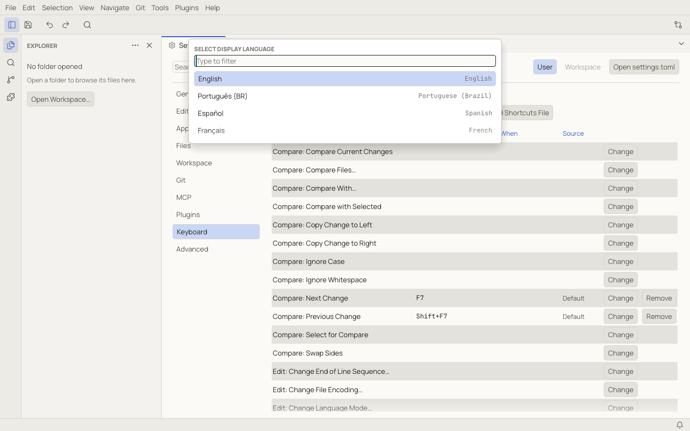
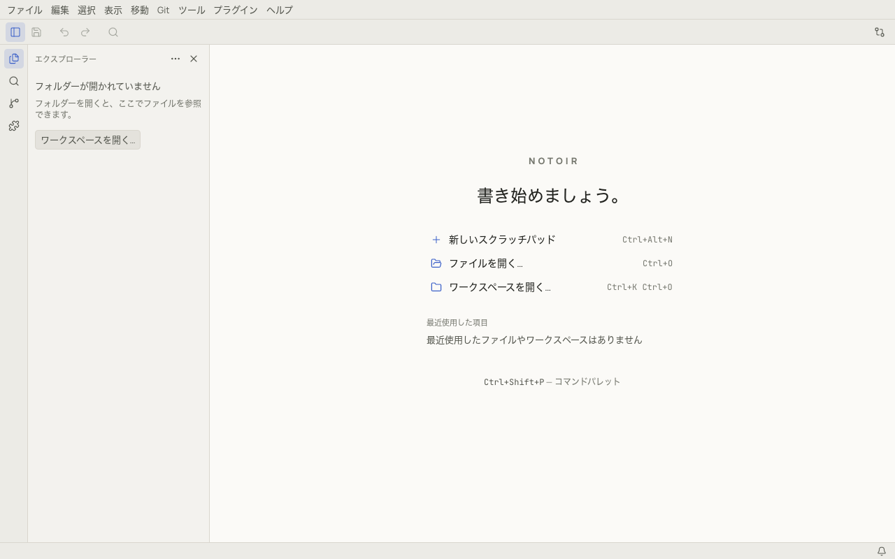
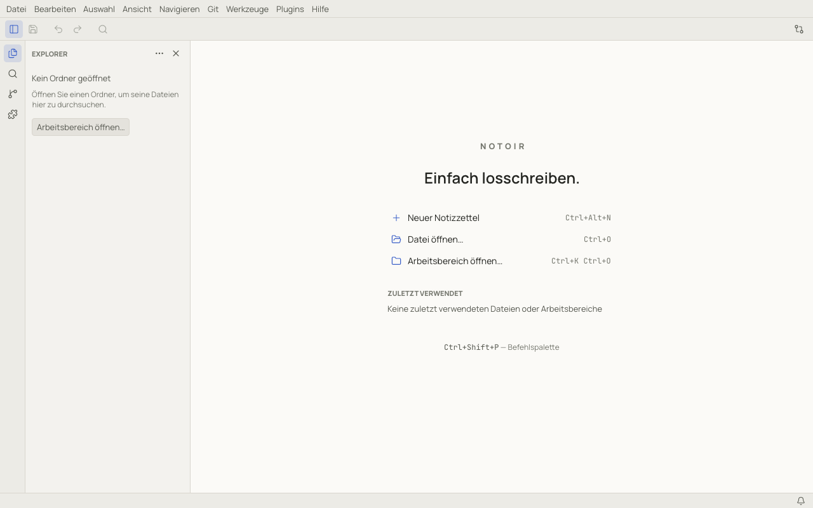

# Languages

Notoir's interface is available in 14 languages. On first launch it follows your system language, falling back to
English. Change it on the Welcome page, with **Tools › Change Display Language…**, or with the `language` setting. The
change applies immediately, without a restart.

| Language | Code |
|---|---|
| English | `en` |
| Português (BR) | `pt-BR` |
| Español | `es` |
| Français | `fr` |
| Deutsch | `de` |
| Italiano | `it` |
| Nederlands | `nl` |
| Polski | `pl` |
| 日本語 | `ja` |
| Русский | `ru` |
| Українська | `uk` |
| Türkçe | `tr` |
| 简体中文 | `zh-CN` |
| 한국어 | `ko` |

- Your own text is never translated, and neither is the name Notoir.
- The command palette and settings search also match English names, whatever the display language.
- Chinese, Japanese and Korean text in documents is shown with your system's fonts.
- Plugins can ship their own translations (see [Writing a plugin](writing-plugins.md#translations)).
