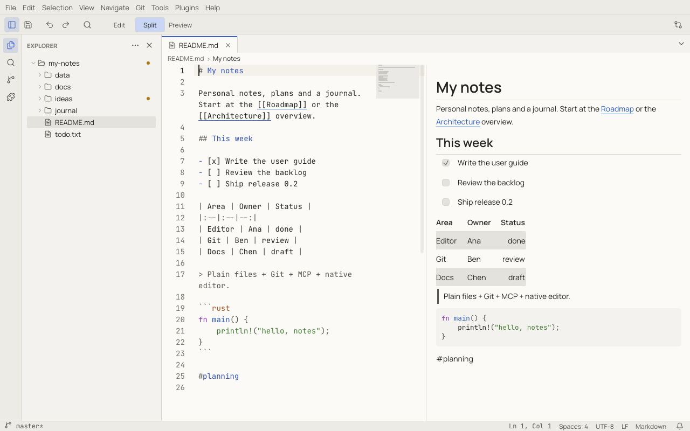
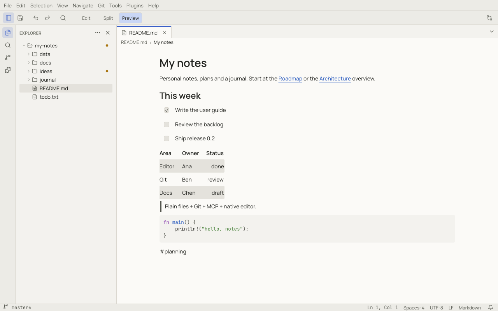

# Markdown

Notoir edits Markdown as plain text with syntax colouring, and renders it in a preview next to the text or instead of
it.

## Edit, Split and Preview

The toolbar shows **Edit / Split / Preview** for a Markdown file:

| Mode | Shows | Shortcut |
|---|---|---|
| Edit (**Show Editor**) | the text only | — |
| Split (**Show Editor and Preview**) | text and preview side by side | — |
| Preview (**Show Preview**) | the rendered document only | — |
| Toggle Preview | switch between Edit and Preview | `Ctrl+Shift+V` (⇧⌘V) |
| Open Preview to the Side | a preview in another group | `Ctrl+K V` (⌘K V) |

The mode is kept per tab. `markdown.defaultMode` chooses the mode new Markdown tabs start in.

In split mode the text and the preview scroll together, and you can drag the divider. When the editor is narrow, the
preview moves below the text. Double-click anywhere in the preview to jump to that place in the text.

## What the preview renders

- Headings, paragraphs, **bold**, *italic*, `code`, ~~strikethrough~~ and links.
- Bulleted, numbered and nested lists, and **task lists**: click a checkbox to tick it in the text (undoable).
- Tables with column alignment. Wide tables and long code lines scroll sideways instead of being cut off.
- Fenced code blocks with syntax highlighting.
- Block quotes, horizontal rules and footnotes.
- Images from local files, including SVG. Remote images show a placeholder.
- Front matter (`---` YAML at the top) as a collapsible block.
- [Wiki links](notes.md#wiki-links) (`[[Note]]`) as links.
- Raw HTML is shown as text, never executed.

Mermaid diagrams and math are not rendered yet.

## Links

Clicking a link in the preview:

- web and mail links open in your browser or mail app;
- links to other files open them in Notoir, at the `#heading` when there is one;
- `#heading` links scroll the preview;
- other kinds of link ask before opening.

## Writing helpers

| Command | Shortcut |
|---|---|
| Toggle Bold | `Ctrl+B` (⌘B) in a Markdown editor (elsewhere it toggles the sidebar) |
| Toggle Italic | `Ctrl+I` (⌘I) |
| Toggle Inline Code | — |
| Insert Link | — |

Pasting a URL over selected text turns the selection into a link. `Enter` continues lists and task lists.

Right-click in Markdown text and open **Insert** for headings (H1–H6), code blocks, quotes, formatting,
lists, images, tables, and horizontal rules. Select text first to format it; each insertion can be undone.
The Code submenu includes common languages, with **More…** for a searchable language list.

**Insert › Link…** opens a caption and destination dialog. Type `@` at the start of the destination to
search workspace files. Exact filenames and filename stems appear before partial and fuzzy matches.
Use the arrow keys and Enter, or click a result, to fill a relative file path, then confirm to insert the link.
**Image…** works the same way, using alternative text instead of a caption and listing only supported image files.
Cancel or Escape closes either dialog without changing the document.

**Insert › Table** asks for the number of columns and data rows (1–100 each). A header row is added automatically.

## Edit tables as worksheets

Hover over a table in Preview or Split and click its pencil icon to open a linked worksheet tab.
You can also place the source cursor inside a table and run **Edit table as worksheet** from the command palette.

Click a cell to select it; Shift-click another to select a rectangle. Arrow keys move between cells.
Double-click, Enter, or F2 starts editing. Inactive cells show rendered Markdown, while the cell you edit shows its
Markdown syntax. Enter or Escape finishes editing; Tab and Shift-Tab move between cells.

The left gutter numbers the rows. Click a number to select its whole row; Shift-click extends a range, and
Ctrl-click (⌘-click on macOS) adds or removes individual rows. Click a column header to select the whole column;
the same modifiers select additional columns. Double-click a header, or use Enter/F2, to edit its text.
Row numbers stay visible when scrolling sideways, and the Markdown header stays visible when scrolling down.

Drag a selected row counter, or any cell in a selected row, to move all selected rows together. A line shows the
drop position; holding near the top or bottom scrolls the worksheet. Escape cancels the drag. One Undo restores
the original order and selection. The Markdown header row is fixed; move data rows below it.

Right-click a row number for **Insert row above**, **Insert row below**, or **Delete selected rows**.
Right-click a column header for **Insert column before**, **Insert column after**, or **Delete selected columns**.
Right-clicking inside the current selection keeps the group; right-clicking outside selects the clicked row or column.
Insertion adds one blank row or column at the corresponding edge of the selection. Deletion removes only selected
rows or columns, including nonadjacent ones. The header row and final column remain protected.

Drag the right edge of a column header to change its width, or the bottom edge of a row number to change its height.
Text wraps inside each column, and taller rows reveal more lines. Double-click a divider to fit a column to its
widest cell or a row to its wrapped content. Escape cancels a resize; focused handles also accept arrow keys.
These sizes belong to the current worksheet view, work with read-only documents, and do not change the saved Markdown.
Row sizes move with reordered rows, and structural undo/redo restores the layout with the table.

The icon toolbar formats text as bold, italic, strikethrough, inline code, or a link. Hover over a tool to see its name.
Bold and italic use `Ctrl+B` / `Ctrl+I`
(⌘B / ⌘I). Formatting applies to selected text inside an active cell, or to the selected cells. **Rows and columns**
adds or deletes rows and columns; **Alignment** changes Markdown column alignment. The header and final column
cannot be deleted. Copy and paste rectangular ranges using tabs and newlines; pasted ranges grow the table as needed.
Line breaks pasted while editing one cell become spaces.

The link icon opens the same **Insert Link** dialog as the Markdown context menu, with **Caption** and **URL or file**.
Type `@` in the destination to complete workspace files. Insert confirms the captured cell or text selection as one
undoable edit; Cancel or Escape leaves it unchanged. When several cells are selected, the caption and destination
apply to each selected cell.
If the cell already contains one link, its caption and destination are filled in for editing. Inside an active cell,
place the caret in a link or select its text to edit that link while preserving the surrounding text.

Changes update the Markdown immediately, share its undo/redo history, and use its normal save and autosave settings.
Escape does not undo changes already made. **Go to Markdown** returns to the source. If source edits break or delete
the table, the worksheet pauses until the table is repaired or restored with Undo.

You can close the source tab and continue in the worksheet. Worksheet tabs last for the current session; reopening
Notoir restores the source document instead.

## Export as HTML

**File › Export as HTML…** saves the document as a standalone web page with a light, dark and print stylesheet built
in. Headings get ids for links, wiki links point at `<Note>.html`, local images stay relative to where you save the
page, and front matter is left out. To get a PDF, open the page in a browser and print it to PDF.
