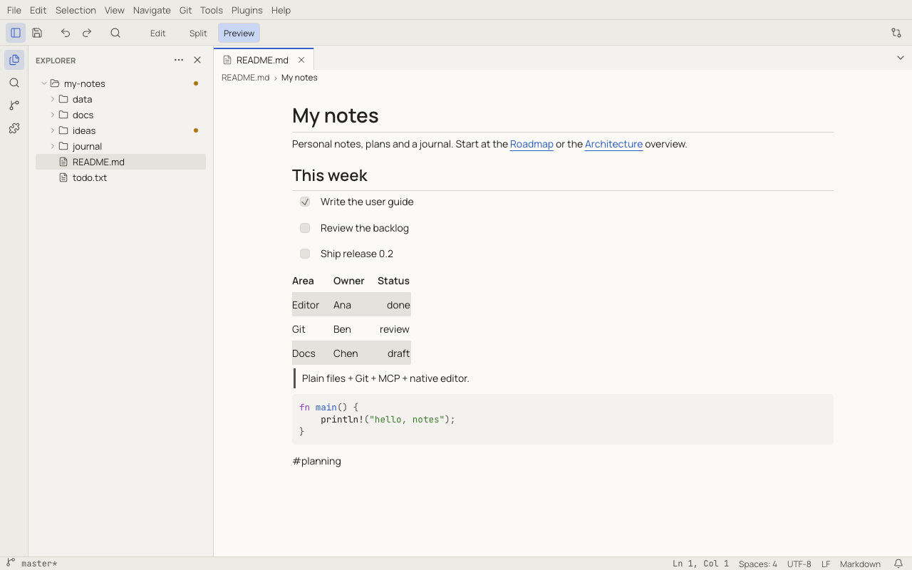

# Markdown

Notoir edits Markdown as plain text with syntax colouring, and renders it in a preview next to the text or instead of
it.

## Edit, Split and Preview

The toolbar shows **Edit / Split / Preview** for a Markdown file:

| Mode | Shows | Shortcut |
|---|---|---|
| Edit (**Show Editor**) | the text only | — |
| Split (**Show Editor and Preview**) | text and preview side by side | — |
| Preview (**Show Preview**) | the rendered document only | — |
| Toggle Preview | switch between Edit and Preview | `Ctrl+Shift+V` (⇧⌘V) |
| Open Preview to the Side | a preview in another group | `Ctrl+K V` (⌘K V) |

The mode is kept per tab. `markdown.defaultMode` chooses the mode new Markdown tabs start in.

In split mode the text and the preview scroll together, and you can drag the divider. When the editor is narrow, the
preview moves below the text. Double-click anywhere in the preview to jump to that place in the text.

## What the preview renders

- Headings, paragraphs, **bold**, *italic*, `code`, ~~strikethrough~~ and links.
- Bulleted, numbered and nested lists, and **task lists**: click a checkbox to tick it in the text (undoable).
- Tables with column alignment. Wide tables and long code lines scroll sideways instead of being cut off.
- Fenced code blocks with syntax highlighting.
- Block quotes, horizontal rules and footnotes.
- Images from local files, including SVG. Remote images show a placeholder.
- Front matter (`---` YAML at the top) as a collapsible block.
- [Wiki links](notes.md#wiki-links) (`[[Note]]`) as links.
- Raw HTML is shown as text, never executed.

Mermaid diagrams and math are not rendered yet.

## Links

Clicking a link in the preview:

- web and mail links open in your browser or mail app;
- links to other files open them in Notoir, at the `#heading` when there is one;
- `#heading` links scroll the preview;
- other kinds of link ask before opening.

## Writing helpers

| Command | Shortcut |
|---|---|
| Toggle Bold | `Ctrl+B` (⌘B) in a Markdown editor (elsewhere it toggles the sidebar) |
| Toggle Italic | `Ctrl+I` (⌘I) |
| Toggle Inline Code | — |
| Insert Link | — |

Pasting a URL over selected text turns the selection into a link. `Enter` continues lists and task lists.

## Export as HTML

**File › Export as HTML…** saves the document as a standalone web page with a light, dark and print stylesheet built
in. Headings get ids for links, wiki links point at `<Note>.html`, local images stay relative to where you save the
page, and front matter is left out. To get a PDF, open the page in a browser and print it to PDF.
