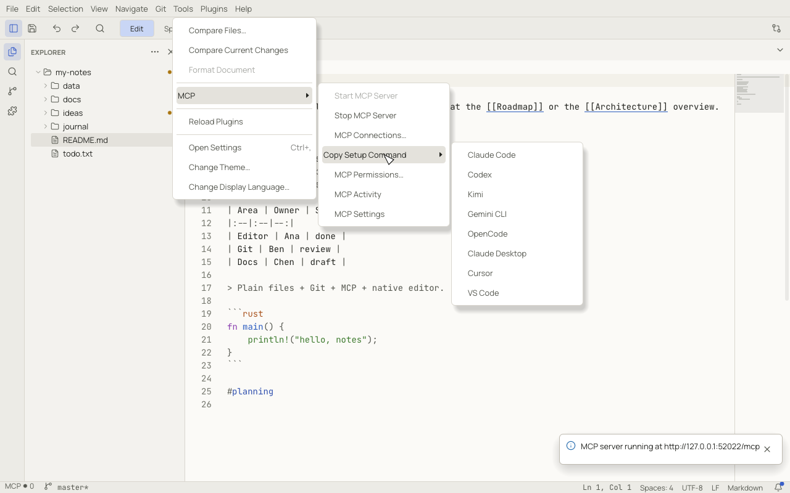
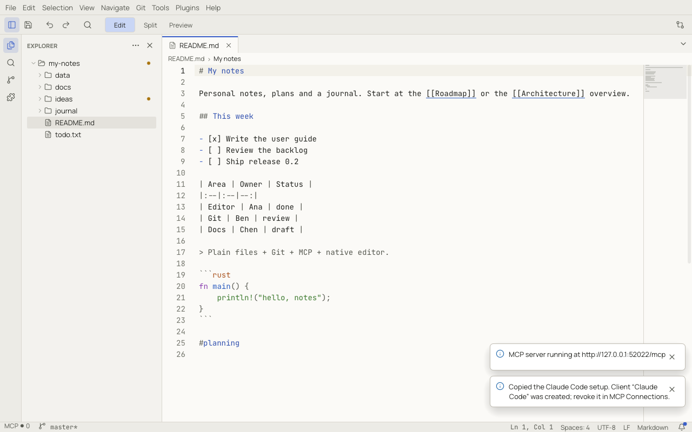
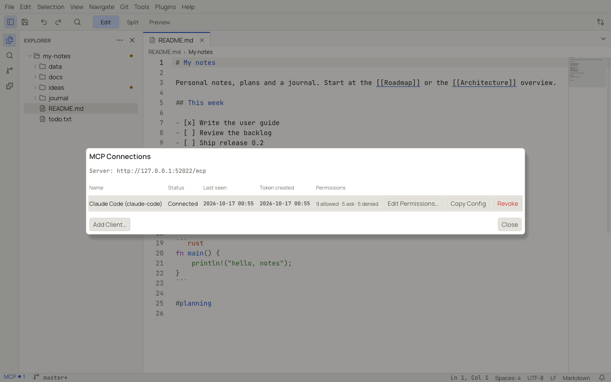
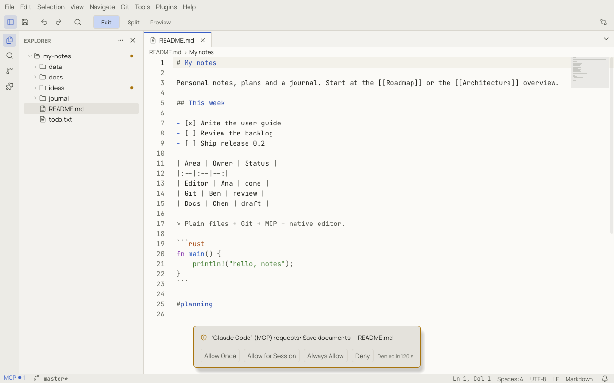
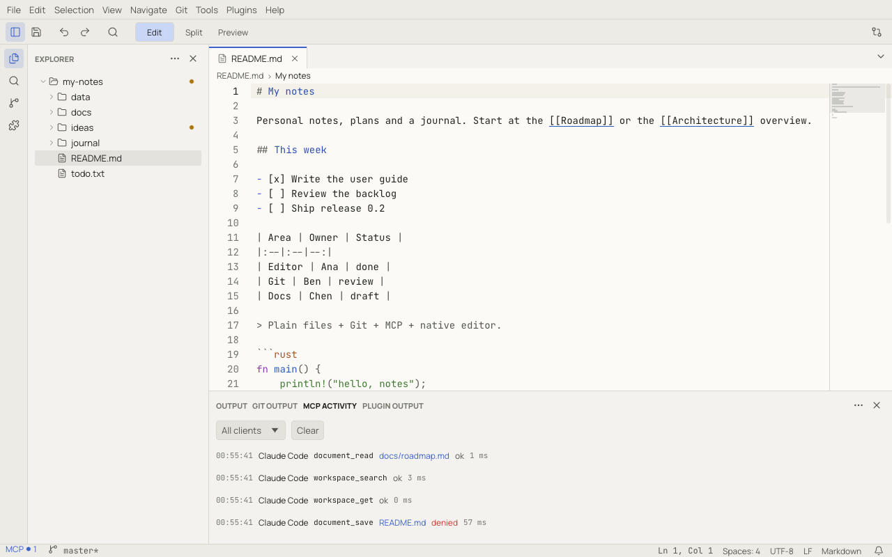

# MCP: connecting AI clients

Notoir includes an [MCP](https://modelcontextprotocol.io) server. AI clients such as Claude Code, Claude Desktop,
Codex, Cursor, VS Code, Gemini CLI, Kimi and OpenCode can use it to search your workspace, read documents, and edit
them **inside Notoir**: edits appear live in your tabs, are undoable, and go through the same save pipeline and
recovery as your own typing.

The server listens only on your own machine (`127.0.0.1`), needs a token for every request, and checks every action
against permissions you control.

## Start the server

**Tools › MCP › Start MCP Server**. A notification shows the address, for example
`http://127.0.0.1:47823/mcp`. While the server runs, the status bar shows **MCP ●N** with the number of connected
clients; click it for a popover with the address, the connected clients, recent activity and links to
**Connections…** and **Activity…**.

The server uses port 47823 (`mcp.port`), or the next free port if that one is taken. Set `mcp.autoStart` to start it
with Notoir. **Stop MCP Server** disconnects every client.

## Connect a client in one step

**Tools › MCP › Copy Setup Command** has an entry per client. Choosing one creates a client in Notoir named after it
("Codex", then "Codex 2"…), with its own token, and copies a ready-to-paste setup to the clipboard.

Then paste it where that client expects it:

| Client | What is copied | Where to paste it |
|---|---|---|
| Claude Code | `claude mcp add --transport http notoir <url> --header "Authorization: Bearer <token>"` | run it in a terminal |
| Codex | `codex mcp add notoir -- <notoir> mcp-bridge --token <token> --port <port>` | run it in a terminal |
| Kimi | `kimi mcp add --transport http notoir <url> --header "Authorization: Bearer <token>"` | run it in a terminal |
| Gemini CLI | `gemini mcp add --transport http notoir <url> --header "Authorization: Bearer <token>"` | run it in a terminal |
| VS Code | `code --add-mcp '{"name":"notoir","type":"http",…}'` | run it in a terminal |
| OpenCode | an `opencode.json` snippet with a `remote` server | merge it into `opencode.json` (project) or `~/.config/opencode/opencode.json` |
| Cursor | an `mcpServers` JSON snippet with the URL and header | merge it into `~/.cursor/mcp.json` (or `.cursor/mcp.json` in a project) |
| Claude Desktop | an `mcpServers` JSON snippet that runs `notoir mcp-bridge` | merge it into `claude_desktop_config.json` (**Settings › Developer › Edit Config** in Claude Desktop), then restart it |

A notification confirms which client was created:

> The copied text contains the client's token. Treat it like a password: anyone with it can use the permissions of
> that client while Notoir runs. Revoke the client in **MCP Connections** if it leaks.

Codex and Claude Desktop connect through `notoir mcp-bridge`, a small stdio-to-HTTP bridge built into the `notoir`
executable. The bridge only talks to a running Notoir; it never starts one.

## Connections

**Tools › MCP › MCP Connections…** lists your clients: status, last seen, when the token was created and a summary of
the permissions.

- **Add Client…** creates a client with a name you choose and shows its token once, with setup snippets for Claude
  Code and Claude Desktop. Copy the token then; Notoir only stores a hash of it.
- **Edit Permissions…** opens the permissions of that client.
- **Copy Config** copies a setup snippet again.
- **Revoke** rejects the token immediately and disconnects the client.

## Permissions

Every client has its own permissions, each set to **Allow**, **Ask** or **Deny**. New clients start with these
defaults:

| Allowed | Asks | Denied |
|---|---|---|
| read and search workspace files; open files in Notoir; modify documents (undoable); read tabs and the active document; control the editor; view Git status and diffs; read settings; raw filesystem reads | create files and documents; save documents; rename files; raw filesystem writes (every time) | delete files; access outside the workspace; commit; push; modify settings; run arbitrary commands |

Change them with **Tools › MCP › MCP Permissions…** or **Edit Permissions…** in Connections. **Reset to Defaults**
restores this table.

When a client does something set to **Ask**, a prompt appears above the status bar without interrupting your typing:

- **Allow Once** allows this request.
- **Allow for Session** allows this kind of request until Notoir quits (or **Clear** in the permissions dialog).
- **Always Allow** stores the permission. For risky permissions it asks you to confirm.
- **Deny**, or no answer within 120 seconds, refuses the request.

`F6` moves the keyboard focus to the prompt. Identical requests waiting at the same time are answered together.

## Activity

**Tools › MCP › MCP Activity** opens the activity log in the bottom panel: every tool call with its time, client, tool,
target, result (*ok*, *denied* or *rejected*) and duration. Edits show the lines they added and removed. Filter by
client, or **Clear** the log. Entries are kept for `mcp.activityRetentionDays` days (14 by default); times are in UTC.

## How edits behave

- Documents a client opens are loaded into Notoir's memory without opening a tab. When a client edits one, it opens as
  a background tab so you can see the change.
- Each edit is one undoable step, briefly highlighted in the editor (`mcp.highlightEdits`).
- Clients can pass the revision they last read; if you changed the document since, the edit is refused instead of
  overwriting your work.
- Raw filesystem writes go to disk directly; if the file is open, you get the usual
  [changed on disk](files.md#files-changed-outside-notoir) banner, naming the client.
- Large reads without a line range are capped at `mcp.maxReadBytes`.

The [MCP tools reference](reference/mcp-tools.md) lists every tool, its parameters and the permission it needs.
