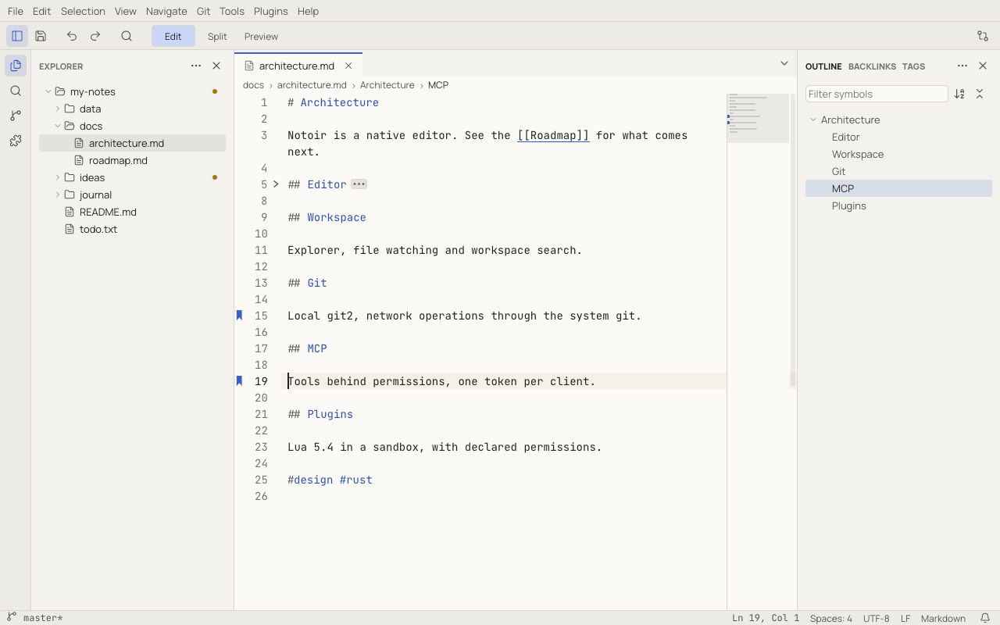

# Navigating a document

## Go to line and symbol

- **Go to Line…** (`Ctrl+G`, ⌃G), or click the cursor position in the status bar. Type `42` or `42:7`; the editor
  previews the spot as you type and `Escape` takes you back.
- **Go to Symbol in Editor…** (`Ctrl+Shift+O`, ⇧⌘O) lists the headings of a Markdown file or the keys of a JSON, YAML
  or TOML file. You can also type `@` in [Quick Open](workspaces.md#quick-open).

## Back and forward

Notoir remembers where you were: switching documents and jumping more than a few lines (`navigation.minLineDistance`)
both record a spot. **Go Back** (`Alt+Left`, ⌃-) and **Go Forward** (`Alt+Right`, ⌃⇧-) move through that history,
reopening closed files when needed. The back and forward buttons of a mouse work too.

## Outline

**View › Panels › Outline** shows the structure of the current document in the secondary sidebar: Markdown headings,
or JSON, YAML and TOML keys down to `outline.depth` levels. Click an entry to jump to it. The entry at the cursor is
highlighted as you move. The panel has a filter box, **Sort by Name / Position** and **Collapse All / Expand All**.

Plugins can add outlines for other languages.

## Breadcrumbs

The bar under the tabs shows where you are: folders, file, then the heading or key path at the cursor. Click a segment
to pick a sibling file or symbol. **Focus Breadcrumbs** (`Ctrl+Shift+.`, ⇧⌘.) does it from the keyboard. Hide the bar
with **View › Appearance › Breadcrumbs**.

## Folding

Click the arrow in the gutter next to a line to fold its block. Notoir folds Markdown sections, code blocks, lists and
tables; brackets in JSON and code; indentation elsewhere; and `#region` / `#endregion` markers. A folded block shows a
`⋯` chip; click it to unfold.

| Command | Shortcut |
|---|---|
| Fold / Unfold | `Ctrl+Shift+[` / `Ctrl+Shift+]` (⌥⌘[ / ⌥⌘]) |
| Toggle Fold | `Ctrl+K Ctrl+L` (⌘K ⌘L) |
| Fold All / Unfold All | `Ctrl+K Ctrl+0` / `Ctrl+K Ctrl+J` (⌘K ⌘0 / ⌘K ⌘J) |
| Fold Level 1–7 | `Ctrl+K Ctrl+1` … `Ctrl+K Ctrl+7` (⌘K ⌘1 …) |
| Fold All Except Current | — |

Folds are remembered per tab across restarts.

## Bookmarks

Bookmarks mark lines you want to come back to. They stay on their line while you edit and are remembered per file in
the workspace.

| Command | Shortcut |
|---|---|
| Toggle Bookmark | `Ctrl+F2` (⌘F2), or click the gutter left of the line numbers |
| Next / Previous Bookmark | `F2` / `Shift+F2` |
| Clear Bookmarks in Document / Clear All Bookmarks | — |

Next and Previous wrap around the file. With `bookmarks.navigateAcrossFiles` on, they continue into other open files.

## Minimap

The minimap on the right of the editor shows the shape of the whole document, the visible area, search matches,
selections, bookmarks and Git changes. Click or drag it to scroll. Right-click it to hide it, move it to the left or
change its scale. It is hidden in narrow editors and in large-file mode.
