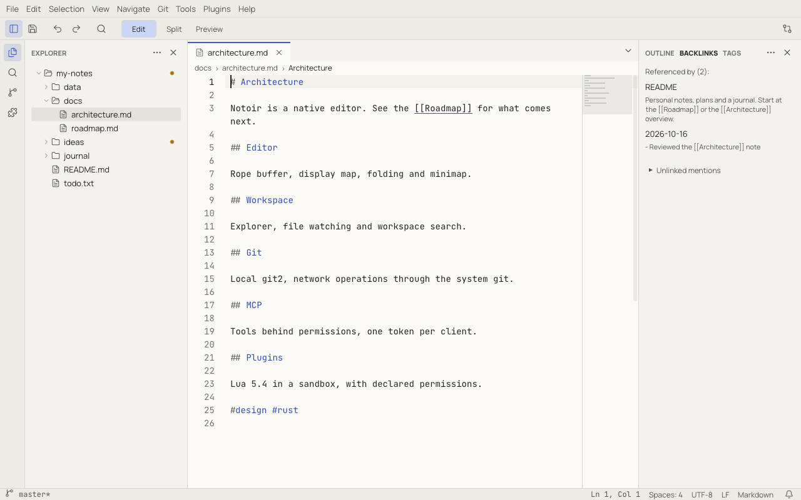
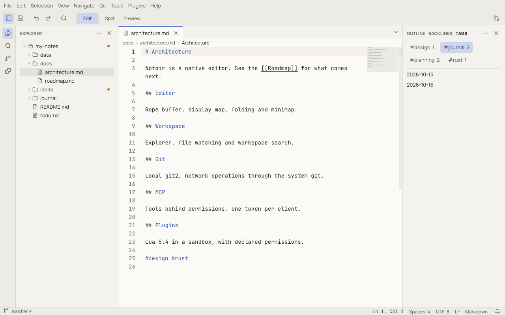

# Notes: links, backlinks, tags and templates

A workspace of Markdown files works as a connected notebook. The notes stay plain files: links and tags are ordinary
text that any other tool can read.

## Wiki links

Link to another note by writing its name in double brackets:

```markdown
See the [[Roadmap]] and the [[Architecture#Git|Git section]].
```

| Form | Links to |
|---|---|
| `[[Roadmap]]` | the note named `Roadmap` (`Roadmap.md`, `roadmap.md`… anywhere in the workspace) |
| `[[Roadmap#Next]]` | the heading *Next* in that note |
| `[[Roadmap\|the plan]]` | the same note, shown as *the plan* |
| `[[docs/roadmap]]` | a path, relative to the current note or the workspace root |

Names are matched without regard to case. When several notes have the same name, the one next to the current note
wins; otherwise Notoir asks which one you mean. Links inside code and front matter are ignored.

- **Follow a link** with `Ctrl`+click (⌘+click), or put the cursor on it and press `Alt+Enter` (⌥↩). The target opens
  at the linked heading.
- **Type `[[`** to get completion from your note names. Use the arrow keys, then `Enter` or `Tab`.
- The editor underlines links. A link to a note that does not exist is dashed; following it offers to create the
  note next to the current one.
- The [Markdown preview](markdown.md) shows links as links, and missing ones dashed with an icon.
- **Renaming a note** in the Explorer offers to update every link to it. Open notes are updated as one undoable edit
  each; closed ones are rewritten on disk.

## Backlinks

**View › Panels › Backlinks** (in the secondary sidebar) lists the notes that link to the current note, each with the
line that contains the link. Click an entry to open it there. **Unlinked mentions** lists notes that mention the
title without linking it.



## Tags

Write `#tag` anywhere in the text, or list tags in the front matter:

```markdown
---
tags: [planning, rust]
---
```

The **Tags** panel lists every tag with the number of notes that use it; click a tag to list those notes. In
[Quick Open](workspaces.md#quick-open), type `#` to list tags, then pick one to list its notes.



The link and tag index is rebuilt from the files as the workspace changes, including your unsaved edits.
**Rebuild Notes Index** (in the command palette) rebuilds it on demand.

## Templates

**File › New File from Template…** creates a note from a template:

1. Pick a template. Shared templates live in the workspace at `.notoir/templates/*.md`; personal ones in the
   `templates` folder of your config directory (see [data locations](troubleshooting.md#where-notoir-keeps-its-data)).
2. Type the file name inline in the Explorer. The template's extension is added if you leave it out.
3. The note opens filled in, with the cursor where the template says.

Placeholders in a template:

| Placeholder | Becomes |
|---|---|
| `{{date}}` | today's date, `YYYY-MM-DD` |
| `{{time}}` | the time, `HH:MM` |
| `{{title}}` | the new file's name without its extension |
| `{{cursor}}` | where the cursor starts |

Example `.notoir/templates/meeting.md`:

```markdown
# {{title}}

Date: {{date}} {{time}}

## Notes

{{cursor}}

#meeting
```

Without a workspace, the template becomes an untitled document.

## Full-text search index

[Workspace search](find-and-search.md#search-in-the-workspace) keeps a full-text index of the workspace in Notoir's
cache folder, so searches in large notebooks return quickly. The index is kept up to date in the background; while it
catches up, searches read the files directly and say so. Turn it off with `search.useIndex`, and run **Rebuild Search Index** from
the command palette if results ever look wrong.
