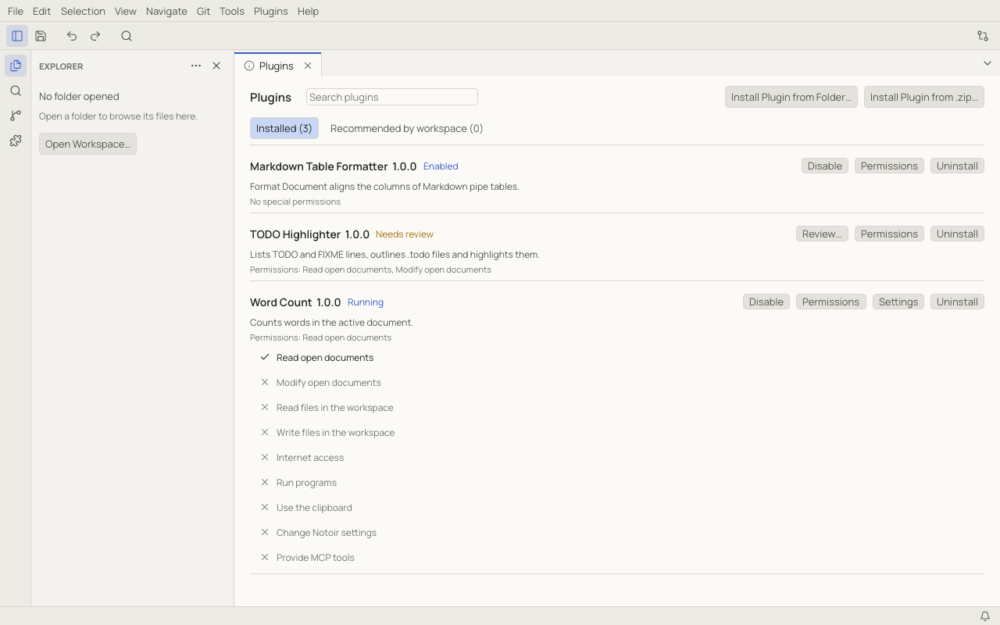
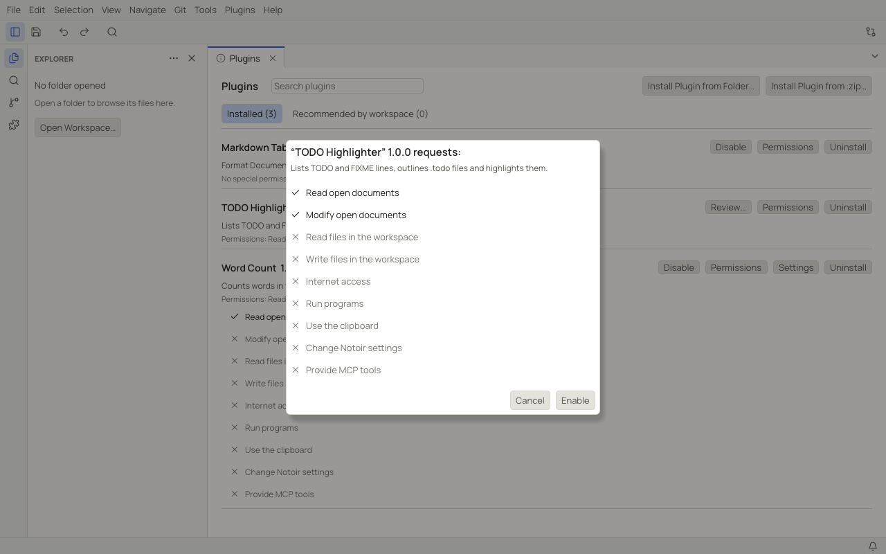

# Using plugins

Plugins add commands, keyboard shortcuts, menu items, status bar items, side panels, settings, formatters, outlines
and new languages to Notoir. They are written in Lua and run in a sandbox: a plugin can only do what you approved, and
it can never freeze or crash Notoir.

## The Plugin Manager

**Plugins › Plugin Manager** opens the manager in a tab.

- **Installed** lists your plugins with their state: *Enabled* or *Running*, *Disabled*, *Needs review*, *Invalid* (the
  manifest has an error) or *Incompatible* (written for another API version).
- **Recommended by workspace** lists plugins the open workspace suggests in `.notoir/plugins.toml`. They are never
  installed or enabled automatically.
- Each plugin has **Enable** / **Disable**, **Review…**, **Permissions** (what it may do, and grants you can revoke),
  **Settings** when it has any, and **Uninstall** (moves it to the trash after asking).
- **Search plugins** filters the list.

## Installing a plugin

Use **Install Plugin from Folder…** or **Install Plugin from .zip…** (in the manager or the **Plugins** menu). Notoir
shows what the plugin asks for, and installs it only when you agree:

| Permission | Allows the plugin to |
|---|---|
| Read open documents | read the text of open documents |
| Modify open documents | change open documents (each change is undoable) |
| Read files in the workspace | read files inside the open workspace |
| Write files in the workspace | create and change files inside the workspace |
| Internet access | make HTTP requests, optionally only to listed hosts |
| Run programs | run programs on your computer; Notoir asks every time unless you choose always allow |
| Use the clipboard | read and write the clipboard |
| Change Notoir settings | change your settings (a plugin can always change its own settings) |
| Provide MCP tools | reserved for a future version |

A plugin copied into the plugins folder by hand, or updated to a version that asks for more permissions, is disabled
until you review it with **Review…**.

## When a plugin misbehaves

If a plugin raises an error, a notification says so with **View Error**. After three errors within a minute, or if it
uses too much memory or time, Notoir disables it and offers **Re-enable**.

- **Plugins › Plugin Output** shows plugin logs and errors.
- **Plugins › Plugin Developer Tools** shows, per plugin, its state, what activated it, how often it called each API,
  its last error and missing translations, with a button to reload it.
- **Plugins › Reload Plugins** reloads every plugin and re-reads their manifests.

## Where plugins live

Plugins are folders inside the `plugins` folder of Notoir's data directory (**Plugins › Open Plugins Folder**; see
[data locations](troubleshooting.md#where-notoir-keeps-its-data)). The `plugins.directory` setting moves it.

## Example plugins

The Notoir repository has three example plugins in
[`plugins/examples`](https://github.com/lvendrame/notoir/tree/main/plugins/examples):

| Plugin | What it does |
|---|---|
| Word Count | counts the words of the current document in the status bar (`Ctrl+Alt+W` / ⌥⌘W shows the total) |
| TODO Highlighter | lists `TODO` and `FIXME` lines in a side panel; adds a `.todo` file language with an outline |
| Markdown Table Formatter | **Format Document** aligns the columns of Markdown tables |

Download the repository, then install one with **Install Plugin from Folder…**. To write your own, see
[Writing a plugin](writing-plugins.md).
