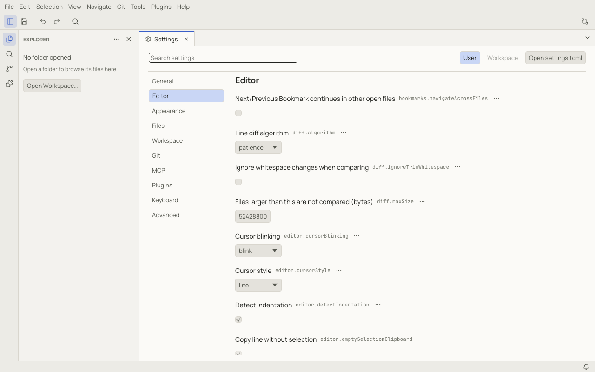

# Settings

Open the Settings tab with **Tools › Open Settings** (`Ctrl+,`, ⌘,).



- Categories on the left: General, Editor, Appearance, Files, Workspace, Git, MCP, Plugins, Keyboard, Advanced.
- **Search settings** matches titles and ids, in your display language and in English. Type `@modified` to list only
  the settings you changed.
- **User** / **Workspace** at the top chooses where a change is written (see scopes below). Rows show whether a value
  is modified, or overridden by the workspace.
- Each row's **⋯** menu has **Reset Setting**, **Copy Setting ID** and **Copy Setting as TOML**.
- Changes apply immediately; there is no Save button.

Every setting, with its type and default, is listed in the [Settings reference](reference/settings.md).

## Settings files

Settings are stored as TOML text files, which you can also edit by hand. **Open settings.toml** in the Settings tab (or
**Preferences: Open User Settings File** in the palette) opens the user file. Saved edits apply immediately. Notoir keeps your
comments and ordering when it writes to the file.

```toml
language = "pt-BR"

[workbench]
theme = "notoir-paper"

[editor]
fontSize = 15
wordWrap = "on"

[editor.minimap]
enabled = false

[files]
autoSave = "afterDelay"

# Only for Markdown files:
["[markdown]".editor]
tabSize = 2
```

If a file has a syntax error, Notoir keeps the last good values and shows a warning with the line and column. Keys it
does not know (for example from a removed plugin) are kept and listed under **Unknown settings**.

## Scopes

A setting can be set at several levels; the most specific one wins:

1. **Workspace, for one language**: `["[markdown]".editor]` in the workspace file
2. **Workspace**: `<workspace>/.notoir/settings.toml`, shared with everyone who opens the folder
3. **User, for one language**: `["[markdown]".editor]` in your user file
4. **User**: `settings.toml` in your config folder (see [data locations](troubleshooting.md#where-notoir-keeps-its-data))
5. Notoir's default for that language (word wrap is on for Markdown and plain text)
6. Notoir's default

Some settings only make sense per machine (for example `mcp.port` or `git.path`) and can only be set for the user.
A few settings marked *trusted workspaces only* in the reference are ignored in a workspace file until you trust that
workspace (see [Workspace settings and trust](workspaces.md#workspace-settings-and-trust)). An invalid value is
skipped with a warning and the next level applies.

The `.notoir` folder is created only when you first save a workspace setting.
