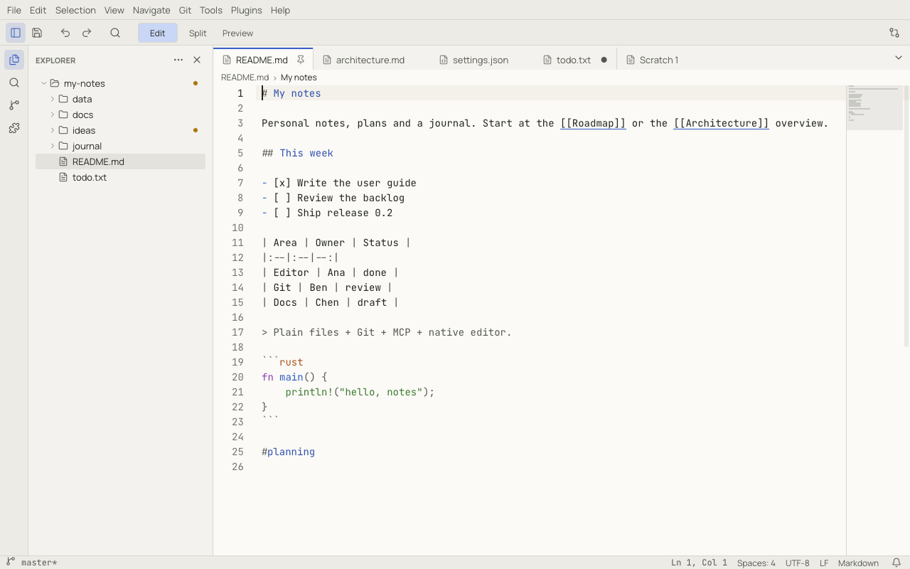
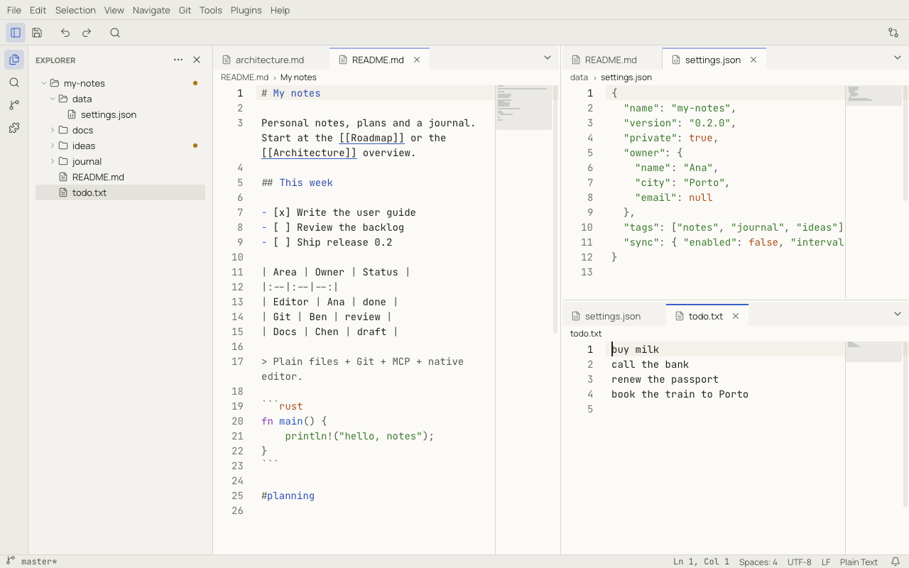

# Tabs, groups and splits

## Tabs

Each open document has a tab. A dot (●) marks unsaved changes; a pin marks a pinned tab, which stays at the left and is
not closed by **Close Others**, **Close Tabs to the Right** or **Close Saved Tabs** (**Close All** closes it too unless `workbench.tabs.closeAllKeepsPinned` is on). When two open files share a name, their tabs add a folder to tell
them apart.

- Click to switch; middle-click or the × to close. Double-click the empty part of the strip for a new untitled file.
- **Next Tab** / **Previous Tab**: `Ctrl+PageDown` / `Ctrl+PageUp` (⌥⌘→ / ⌥⌘←).
- **Switch to Previous Tab**: `Ctrl+Tab` (⌃Tab) goes back to the tab you used last.
- **Reopen Closed Tab**: `Ctrl+Shift+T` (⇧⌘T).
- Drag a tab to reorder it.
- When tabs do not fit, the **⌄** button at the end of the strip lists all of them.

Right-click a tab for **Save**, **Close**, **Close Others**, **Close Tabs to the Right**, **Close Saved Tabs**, **Close
All**, **Duplicate View**, **Compare With…** / **Select for Compare**, the split and move commands, **Pin Tab** /
**Unpin Tab**, **Copy Path**, **Copy Relative Path** and **Reveal in Finder / File Explorer**. The menu acts on the
tab you right-clicked.

## Groups and splits

The editor area can be divided into **groups**, each with its own tabs. A document can be open in several groups at
once; all its views show the same text and edits appear everywhere immediately, while each view keeps its own cursor,
scroll position and folding.

| To | Use |
|---|---|
| Split the current tab to the right | **View › Editor Layout › Split Right**, `Ctrl+\` (⌘\) |
| Split up, down or left | **View › Editor Layout** |
| Move the tab to the next / previous group | **Move Tab to Next Group** / **Move Tab to Previous Group** |
| Focus another group | `Ctrl+K Ctrl+Right` / `Ctrl+K Ctrl+Left` (⌘K ⌘→ / ⌘K ⌘←), or click it |
| Give one group the whole area | **View › Editor Layout › Maximize Editor Group** (again to restore) |
| Go back to a single group | **View › Editor Layout › Single Editor** |
| Open a second view of the same document | **Duplicate View** in the tab menu |

### Drag and drop

Drag a tab to another group's tab strip to move it there. Drag it onto the edge of an editor to create a new split on
that side; a preview shows where it will land. Hold `Alt` (⌥) while dropping to copy the tab instead of moving it.
`Escape` cancels the drag.

Files dragged from the Explorer or from your file manager can be dropped the same way.

Drag the line between two groups to resize them. Layouts are restored with the session.
