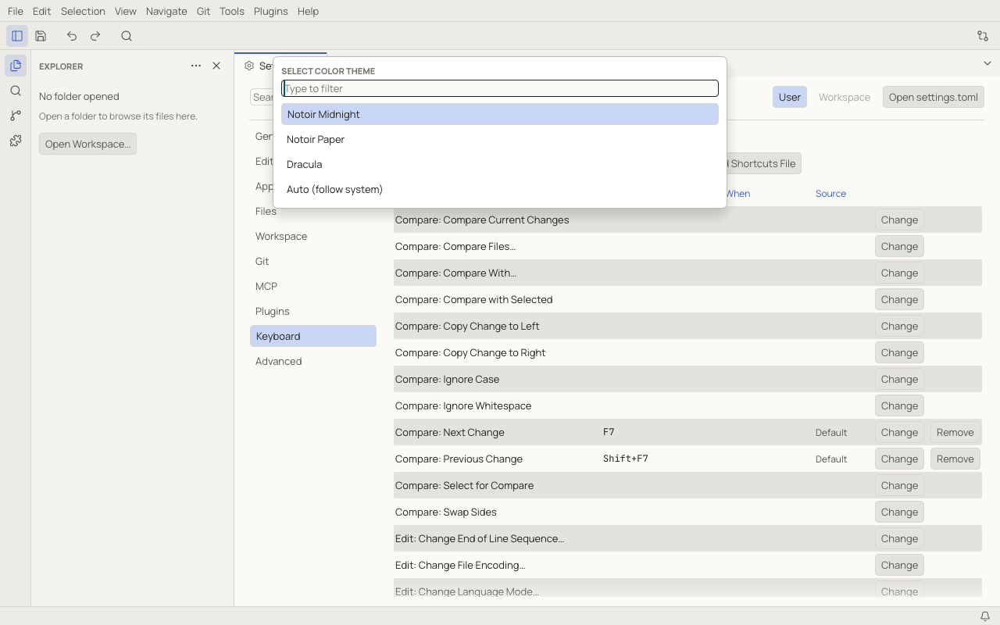
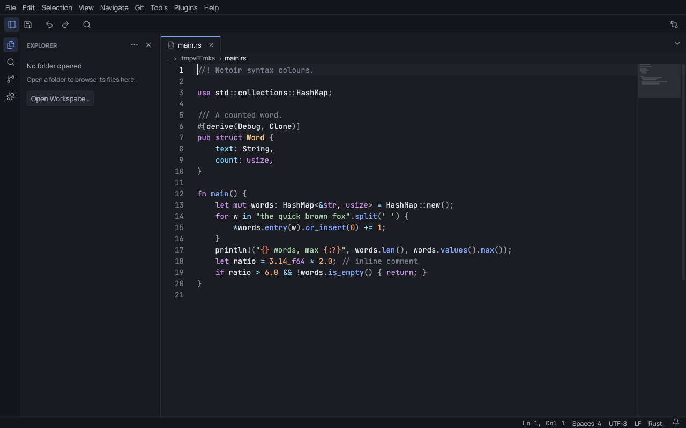
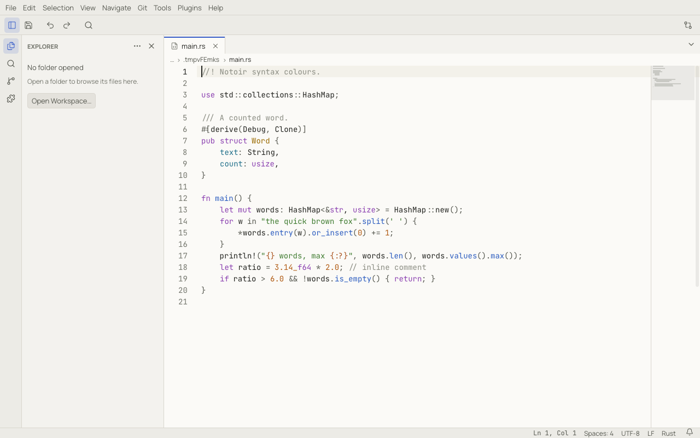
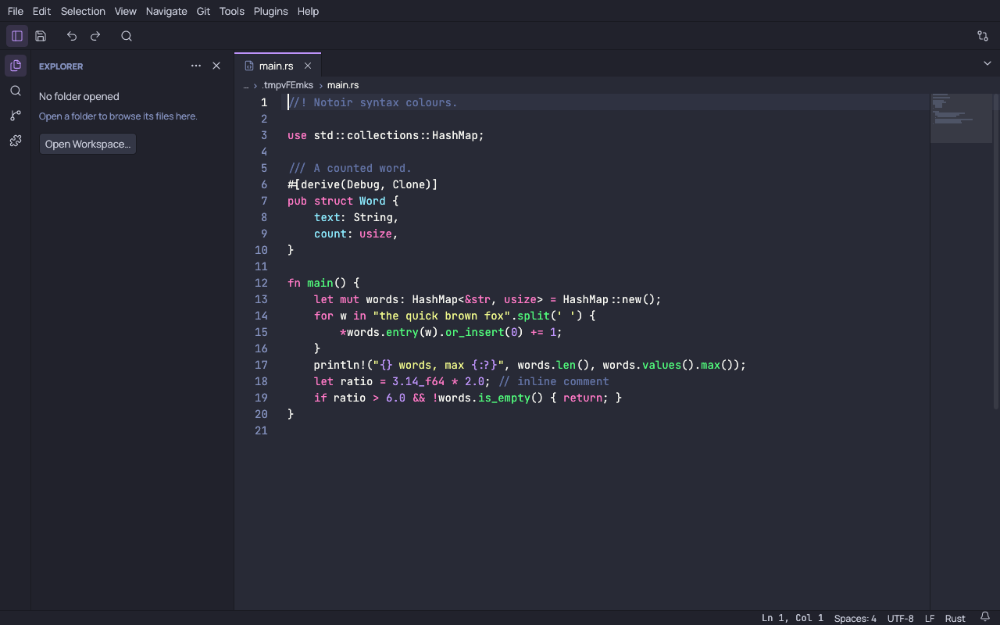

# Themes

**Tools › Change Theme…** opens the theme picker. Moving through the list previews each theme; `Enter` keeps it and
`Escape` goes back to the previous one. The choice is stored in the `workbench.theme` setting.



## Built-in themes

| Theme | Id |
|---|---|
| Notoir Midnight (dark, the default) | `notoir-midnight` |
| Notoir Paper (light) | `notoir-paper` |
| Dracula (dark) | `dracula` |
| Auto (follow system) | `auto`: Notoir Paper when the system is in light mode, Notoir Midnight in dark mode |







## Fonts and size

The interface uses Manrope and the editor uses JetBrains Mono, both bundled. Change the editor font with
`editor.fontFamily` (any installed font), its size with `editor.fontSize` and line spacing with `editor.lineHeight`.
`workbench.uiScale` scales the whole interface. Chinese, Japanese and Korean text uses your system's fonts.

## Custom themes

A theme is a TOML file in the `themes` folder of your config directory (see
[data locations](troubleshooting.md#where-notoir-keeps-its-data)). Notoir reads that folder at startup and again
whenever it changes, so a saved edit shows up right away. Custom themes appear in the theme picker and in the Settings
dropdown.

```toml
[meta]
id = "my-sepia"          # unique; selected with workbench.theme = "my-sepia"
name = "My Sepia"
kind = "light"           # light or dark
format = 1

[ui]
"bg.app" = "#efe6d4"
"bg.editor" = "#f8f1e3"
accent = "#9a5b13"
"accent.soft" = { base = "accent", alpha = 0.14 }

[editor]
foreground = "#3b2f20"

[syntax]
comment = { color = "#8c7a5e", italic = true }
keyword = "#8f3b76"
string = "#4f7a28"
```

- You only need to set the colours you want to change. Everything else comes from Notoir Paper (for `kind = "light"`)
  or Notoir Midnight (for `kind = "dark"`).
- A colour is `"#rrggbb"`, `"#rrggbbaa"`, or a table: `{ base = "accent", alpha = 0.14 }` reuses another token with
  transparency, and syntax entries can add `italic` or `bold`.
- Tables: `[ui]` (window, panels, text, accent, semantic colours), `[editor]` (background, cursor, selection, gutter,
  minimap), `[syntax]` (comment, keyword, string, number, function, type, heading, link…), `[git]` and `[diff]`.
- The built-in theme files list every token:
  [notoir-midnight.toml](https://github.com/lvendrame/notoir/blob/main/assets/themes/notoir-midnight.toml),
  [notoir-paper.toml](https://github.com/lvendrame/notoir/blob/main/assets/themes/notoir-paper.toml) and
  [dracula.toml](https://github.com/lvendrame/notoir/blob/main/assets/themes/dracula.toml).
- A custom theme cannot reuse the id of a built-in theme or `auto`. If a file has an error, Notoir shows a warning
  naming the file and keeps the other themes.
