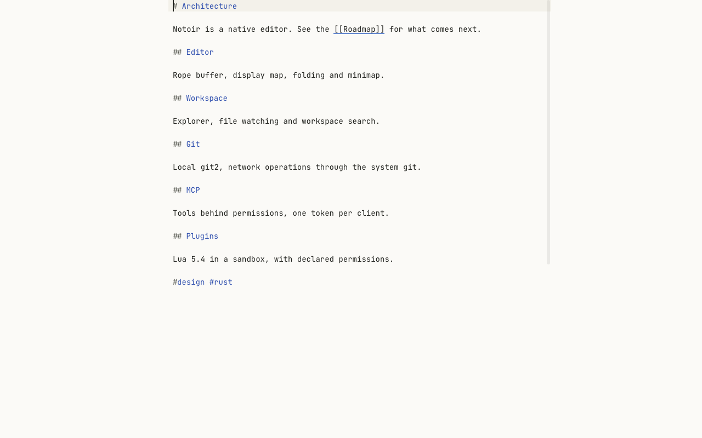

# View options and Zen Mode

## Display options

| Option | Command | Setting |
|---|---|---|
| Word wrap | **Toggle Word Wrap**, `Alt+Z` (⌥Z) | `editor.wordWrap` |
| Line numbers | **View › Appearance › Line Numbers**; **Toggle Relative Line Numbers** in the palette | `editor.lineNumbers` |
| Whitespace characters | **View › Appearance › Whitespace** | `editor.renderWhitespace` |
| Current line highlight | **View › Appearance › Current Line Highlight** | `editor.highlightCurrentLine` |
| Minimap | **View › Appearance › Minimap** | `editor.minimap.enabled` |
| Breadcrumbs | **View › Appearance › Breadcrumbs** | `workbench.breadcrumbs.enabled` |

Toggles from the menu apply to the current view; settings set the default for new views. Word wrap is on by default
for Markdown and plain text.

## Zoom

**Zoom In** (`Ctrl++`, ⌘+), **Zoom Out** (`Ctrl+-`, ⌘-) and **Reset Zoom** (`Ctrl+0`, ⌘0) scale the editor text.
The editor font and size are set with `editor.fontFamily` and `editor.fontSize`, the whole interface with
`workbench.uiScale`.

## Full screen

**Full Screen**: `F11` (⌃⌘F).

## Zen Mode

**Toggle Zen Mode** (`Ctrl+K Z`, ⌘K Z) hides everything except the text: menus, toolbar, panels, other groups, tabs
and line numbers. The text sits in a centred column, and Notoir goes full screen.

Press `Escape` twice, or `Ctrl+K Z` again, to come back exactly to the layout you had. While in Zen Mode, hold `Alt`
(⌥) to show the menu bar. The `zenMode.*` settings choose what Zen Mode hides, whether it goes full screen and how wide
the column is.
