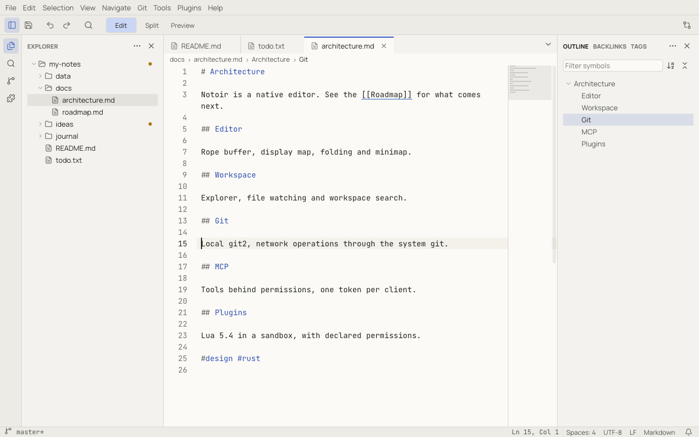
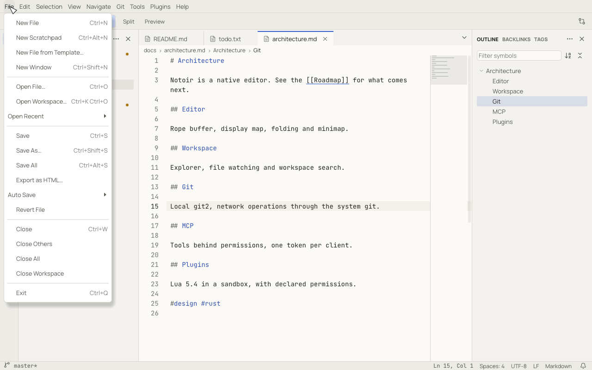

# A tour of the window

From top to bottom:

## Menu bar

**File, Edit, Selection, View, Navigate, Git, Tools, Plugins, Help.** On macOS the menus live in the system menu bar,
with a **Notoir** menu for About, Settings and Quit. Every item is a command, with its shortcut shown on the right.
The complete list is in the [Menus reference](reference/menus.md).

## Toolbar

From the left: show or hide the sidebar, **Save**, **Undo**, **Redo** and **Find**. For a Markdown file the toolbar
adds **Edit / Split / Preview**; for a JSON file it adds **Text / Split / Tree** and **Format**. The button on the right
opens **Compare Files…**.

## Activity bar and sidebars

The narrow bar on the left switches the **primary sidebar** between the **Explorer**, **Search**, **Source Control**
and **Plugins** panels. Click the active icon again, or press `Ctrl+B` (⌘B), to hide the sidebar.

The **secondary sidebar** on the right holds the **Outline**, **Backlinks** and **Tags** panels. Toggle it with
`Ctrl+Alt+B` (⌥⌘B), or open a panel directly with **View › Panels**.

The **bottom panel** (`Ctrl+J`, ⌘J) holds **Output**, **Git Output**, **MCP Activity** and **Plugin Output**.

Use **View › Appearance** to hide the toolbar, status bar or activity bar, or to put the primary sidebar on the right.

## Editor area

Each **editor group** has its own tab strip, and groups can be split in any direction; see
[Tabs, groups and splits](tabs-and-splits.md). Under the tabs, the **breadcrumbs** show the folder, the file and the
heading or key at the cursor. Click a segment to jump to a sibling. Inside the editor, the gutter on the left shows
line numbers, bookmarks, fold controls and Git changes, and the **minimap** on the right gives an overview of the
whole document.

## Status bar

| Item | What it shows | Click to |
|---|---|---|
| Git branch, e.g. `main* ↑1 ↓2` | the branch, `*` for uncommitted changes, commits ahead/behind | switch or create a branch |
| `MCP ●1` | the MCP server is running, with the number of connected clients | open the MCP popover |
| `Ln 15, Col 1` | the cursor position (and the selection size) | **Go to Line…** |
| `Spaces: 4` | the indentation | change tabs/spaces and size, or convert |
| `UTF-8` | the file encoding | reopen or save with another encoding |
| `LF` / `CRLF` | the line endings | convert them |
| `Markdown` | the language mode | pick another language |
| bell | notifications | show the notification list |

Plugins can add their own status items, for example the word count of the
[Word Count example plugin](writing-plugins.md).

## Notifications

Messages appear in the bottom-right corner and collect behind the bell in the status bar. Some carry buttons, such
as **Undo** after a workspace-wide replace or **Reload** for a file changed on disk. Errors stay until you dismiss
them. **Clear All Notifications** empties the list.
