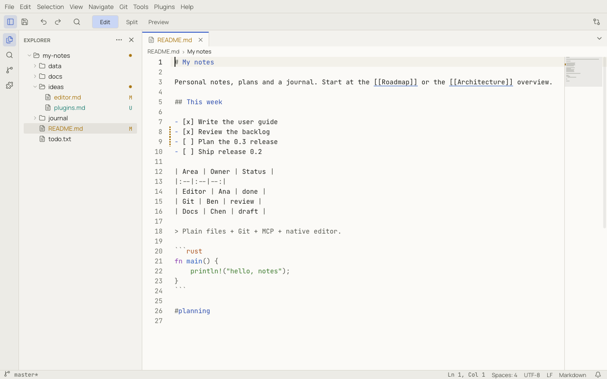
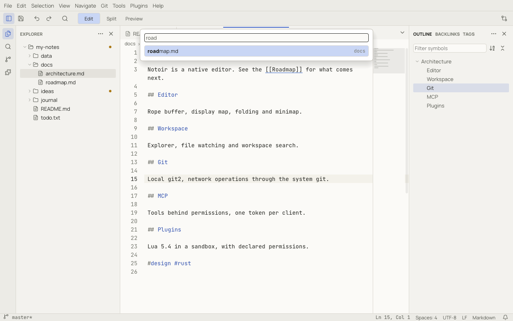

# Workspaces and the Explorer

A **workspace** is a folder opened in Notoir. Opening one gives you the Explorer, workspace search, Quick Open over
all its files, Git, notes links, and a session (tabs and layout) remembered for that folder.

Open one with **File › Open Workspace…** (`Ctrl+K Ctrl+O`, ⌘K ⌘O), by dropping a folder on the window, from
**File › Open Recent**, or with `notoir path/to/folder`. If a workspace is already open, Notoir asks: **Open in This
Window**, **New Window** or **Cancel**. **File › Close Workspace** closes it.

## The Explorer

The Explorer (`Ctrl+Shift+E`, ⇧⌘E) shows the workspace as a tree. It loads folders as you expand them, so huge folders
open instantly, and it follows changes made by other programs.

- **Click** a file to open it; use **Open to the Side** in its context menu to open it in another group.
- **Filter Files in Explorer** (`Ctrl+Alt+F`, ⌥⌘F) narrows the tree to matching names, searching the whole workspace.
- The buttons at the top of the panel (shown on hover) are **New File**, **New Folder**, **Refresh** and **Collapse
  All**. The **⋯** menu has **Show Hidden Files**, **Show Git-Ignored Files** and **Sort Order** (Folders First, Mixed,
  Last Modified).
- The open file is revealed and highlighted automatically.

### File operations

Right-click a file or folder for **New File**, **New Folder**, **Rename…** (`F2`), **Duplicate**, **Delete**, **Copy**,
**Paste**, **Copy Path**, **Copy Relative Path**, **Reveal in Finder / File Explorer**, **Find in Folder…** and the
compare and Git items.

- New names are typed inline. Invalid names (reserved names, illegal characters, duplicates) are explained before
  anything is created.
- **Delete** asks, then moves to the trash (or recycle bin). If the system has no trash, Notoir offers a permanent
  delete with a stronger warning. An open document of a deleted file keeps its text.
- Drag files and folders to move them (with a confirmation, unless `explorer.confirmDragAndDrop` is off); hold `Alt`
  (⌥) to copy instead. Files dropped from your file manager onto a folder are copied into it.
- File operations in the Explorer can be undone with **Undo** while the Explorer has focus.

### Git decorations

In a Git repository, changed files are coloured and marked (`M` modified, `U` untracked, `A` added, `D` deleted, `!`
conflicted), and folders that contain changes get a dot. See [Git](git.md).

## Quick Open

**Navigate › Quick Open…** (`Ctrl+P`, ⌘P) finds any file in the workspace, open document or recent file by typing a
few letters of its name. Matching is fuzzy and matched letters are shown in bold.

- `Enter` opens the file; `Ctrl+Enter` (⌘↩) opens it to the side.
- `name:42` or `name:42:7` opens at a line and column.
- Prefixes switch modes:

| Prefix | Mode |
|---|---|
| `>` | run a command (the [command palette](command-palette.md)) |
| `:` | go to a line in the current file |
| `@` | go to a symbol (heading, key) in the current file |
| `#` | list [tags](notes.md#tags), then the notes that carry them |
| `?` | list the prefixes |

Right after a workspace opens, Quick Open shows *Indexing…* until the file list is ready.

## Sessions

Notoir saves your session every few seconds and when you quit: open tabs (with cursor, scroll and pinned state), the
split layout, panel sizes, expanded Explorer folders and zoom. Each workspace has its own session, and there is one
for when no workspace is open. Reopening the workspace restores everything; files that no longer exist are listed in a
single notice.

The `workbench.startup` setting chooses what happens at launch: restore the last session (default), show the empty
start screen, or show the Welcome page.

## Workspace settings and trust

A workspace can carry its own settings in `.notoir/settings.toml` (see [Settings](settings.md)). Because a cloned
repository could contain settings that affect plugins, MCP or Git, a few *restricted* settings (such as
`mcp.autoStart`) are ignored until you trust the workspace. Notoir shows a notice with **Trust Workspace** and
**Not now** when such settings are present.

A workspace can also recommend plugins in `.notoir/plugins.toml`. They appear in the Plugin Manager under
**Recommended by workspace** and are never installed automatically. See [Using plugins](plugins.md).
